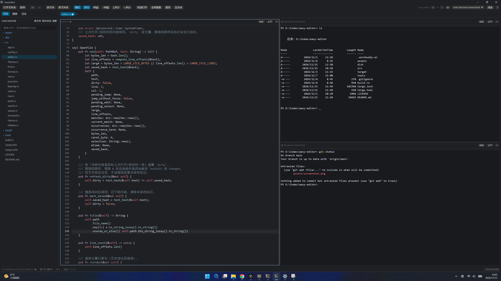

# EasyEditor

**English** | [中文](README.zh-CN.md)

A Windows desktop editor written in **Rust + egui**. It does not have many features — it has the ones you use every day: file tree, multiple terminals, recursive split panes, journal blocks inside plain text files, SQL blocks that run against MySQL with the results sitting right under the text, cursor position back/forward, project-wide search, find and replace, syntax highlighting, and every keybinding is yours to change.

**Current version** v0.3.0 | **Platform** Windows 10 / 11 x64 | **License** MIT

The release package is a **single exe** (about 12 MB, 5.2 MB zipped). No .NET, no Electron, no runtime of any kind.

## Table of contents

- [Highlights](#highlights)
- [Quick start](#quick-start)
- [Usage](#usage)
- [Configuration](#configuration)
- [Tech stack](#tech-stack)
- [Code layout](#code-layout)
- [Build, test and packaging](#build-test-and-packaging)
- [Known limitations](#known-limitations)
- [Implementation notes](#implementation-notes)
- [Contributing and license](#contributing-and-license)

## Highlights

| Feature | In one line | Details |
|---|---|---|
| Code editing | Line numbers, current-line highlight, syntect grammar highlighting; long lines either wrap or scroll sideways | [Editing](#editing) |
| Multiple terminals | Real PTYs via `portable-pty`, VT parsing via `alacritty_terminal`; open several and let each run its own thing | [Terminal](#terminal) |
| Recursive split panes | The tmux / i3 binary pane tree — split as deep as you like, default keys match Windows Terminal | [Split panes](#split-panes) |
| Journal blocks | Task blocks written directly into ordinary text files, mixed with prose and versioned with git | [Journal blocks](#journal-blocks) |
| SQL blocks | Jupyter-style: the query lives in a plain text file, `Ctrl+Enter` runs it and the result lands below the editor. `Ctrl+Alt+N` starts a fresh `query-<timestamp>.sql` with the connection already bound | [SQL blocks](#sql-blocks) |
| Multiple results at once | One panel per statement, so a broken second query does not throw away the first result; batch headers, pop-out windows, copy as TSV, export as CSV, long cells unfolded per row | [Results dock](#results-dock) |
| MySQL connections | Named connections in `config.json`, browsed as connection → database → table, passwords via `env:` so no secret sits on disk. The test verdict (`✓` / `✗` / `⚠`) and the current default are visible wherever the connection is | [Connections](#connections) |
| Cursor position history | Like IDEA's Navigate Back / Forward; a position only counts as a stop after the cursor sits there for 350 ms | [Cursor position history](#cursor-position-history) |
| Find and replace | Case sensitivity, regex, all matches highlighted, hands stay in the input box | [Find and replace](#find-and-replace) |
| Project-wide search | Streams `rg --json` first, falls back to a built-in byte-level scanner when ripgrep is absent | [Project-wide search](#project-wide-search) |
| Word occurrence highlight | Select a word with the mouse and every identical word in the file is marked immediately | [Find and replace](#find-and-replace) |
| JSON / XML formatting | Edits the in-memory buffer only; nothing touches the disk until `Ctrl+S` | [Formatting](#formatting) |
| East Asian input methods | Pinyin and Japanese work in the new-file dialog, the rename box, the editor body and the terminal | [Input methods](#input-methods) |
| CJK / Latin alignment | Baselines are corrected, so Chinese glyphs do not sink to the bottom of the line | [CJK baseline](#cjk-baseline) |
| Light and dark themes | Repaints the Windows system title bar colour and button glyphs along with them | [System title bar](#the-system-title-bar-has-to-be-repainted-by-hand) |
| Custom keybindings | `F1` opens the settings panel: click, press the new chord, done. Conflicts are flagged in red | [Customizing keybindings](#customizing-keybindings) |
| Persistent settings | Font size, theme, terminal preferences and your key changes all live in `%APPDATA%\easy-editor\config.json` | [Configuration](#configuration) |

## Quick start

### Download

Grab one of the packages from the [Releases](https://github.com/PBlueSky/easy-editor/releases) page, unzip it, and double-click `EasyEditor/EasyEditor.exe`:

| Package | Contents | For whom |
|---|---|---|
| `EasyEditor-<version>-windows-x64.zip` | The exe + both READMEs (zh / en) + LICENSE | Most people |
| `EasyEditor-<version>-windows-x64-with-rg.zip` | The above plus `rg.exe` and `THIRD-PARTY-NOTICES.txt` | Anyone who wants project search at full speed |

Both packages work: without `rg.exe`, project-wide search silently falls back to the built-in scanner — a bit slower on large repos. Each package ships with a matching `.sha256.txt`; verify it:

```powershell
Get-FileHash .\EasyEditor-0.3.0-windows-x64.zip -Algorithm SHA256
```

### Run from source

Install a Rust stable toolchain (`rustup`), then:

```bash
git clone https://github.com/PBlueSky/easy-editor.git
cd easy-editor
cargo run --release       # first run compiles dependencies, after that it is fast
```

The debug profile already pins dependencies to `opt-level = 2` (see `Cargo.toml`), so plain `cargo run` is not sluggish either.

```bash
cargo run -- D:\path\to\some-project    # start and open a folder
cargo run -- src\app.rs                 # start and open a file
```

With no arguments, the startup folder is chosen by: **command-line argument > current directory if it looks like a project (`Cargo.toml` or `.git`) > last workspace you opened**.

## Usage

### Interface



```
┌──────────────── Top toolbar (wraps to a second row when it runs out of room) ─────────┐
├──────────┬──────────────────── Centre: pane tree (recursively splittable) ───────────┤
│ Sidebar  │  Tab strip + editor / terminal panes…                                      │
│ Files    ├──────────────────── Bottom: results dock (SQL) ────────────────────────────┤
│ Search   ├──────────────────── Bottom: status bar + find/replace bar ─────────────────┤
│ Journal  │                                                                            │
│ Database │                                                                            │
└──────────┴───────────────────────────────────────────────────────────────────────────┘
```

- **Top toolbar**, left to right: `Open folder` `Save` `←` `→` (cursor history back / forward) `New file` `New folder` `Sidebar` `Wrap` `Terminal` `+Terminal` `‖ Split` `═ Split` `Quick open` `Project search` `Find` `Journal block` `Database`. The `Database` entry is a dropdown (default connection line / `new query` / `insert SQL block` / `run SQL` / `results dock` / `connection manager…` / `sidebar database tree` / `this file is SQL`) — that is the only new button the whole database feature costs. The right-hand group is `Dark` / `Light` (theme), `?` (keybinding settings), the `shell:` dropdown, `⚙` (terminal settings), font size `- 14 +`, and the workspace name.
- **Sidebar** has four tabs: `Files` (the tree), `Search` (project-wide results), `Journal` (blocks in the current file), `Database` (connections → databases → tables → columns). `Ctrl+B` shows or hides it.
- Narrow the window until one row no longer fits and the remaining buttons wrap onto a second row — they never squash together and text is never overdrawn. The right-hand group still anchors right-to-left after wrapping. The file-tree header does the same trick in one row that cannot wrap: `刷新` / `新文件夹` / `新文件` are laid right-to-left first, then the workspace name is placed in the rectangle that is left over and truncated there — a long folder name used to draw straight through `新文件`. Too little room and the name is dropped rather than overlapped; hover it for the full path.

### File tree

Lazy-loaded with `walkdir`; dotfiles are hidden by default. Three entry points create a file or folder: the toolbar button, the button at the top of the tree, and the context menu on any entry. The context menu also offers "Format" (files only, JSON / XML only), "Rename" (files only), "Reveal in Explorer" and "Open terminal here". The root row's context menu adds "Show hidden files" and "Refresh".

When the create dialog opens, the input box has keyboard focus immediately — just type the name. `Enter` creates, `Esc` cancels; there is no need to click the box first. Pinyin and Japanese input methods work normally (see [Input methods](#input-methods)).

The "Rename" box is drawn on the entry's own row, pre-filled with the current name: `Enter` commits, `Esc` cancels, clicking elsewhere commits. Names containing `/ \ : * ? " < > |`, empty names, `.` and `..`, and names that collide with an existing file are rejected with a message at the bottom of the tree — the original file is never touched. **Files already open in a tab follow the new path**, so unsaved changes are written to the new name instead of resurrecting a copy under the old one, and the quick-open index is rescanned. Renaming directories is not supported yet.

"Open terminal here" splits a new terminal pane to the right of the focused pane, with the shell's working directory set to the folder you clicked (or the parent folder, for a file). It does not change the default directory chosen in the toolbar.

There is a **search box** at the top of the tree: type part of a name or relative path and it scans the whole workspace (skipping `.git` / `target` / `node_modules` and similar), case-insensitively, listing up to 500 hits. Click a file to open it; click a directory to expand the tree to its location and leave search mode. Results are cached per query string, so typing continuously does not re-walk the tree every frame.

`Ctrl+P` "Quick open" takes a different path: the index is built once when the workspace opens (up to 50,000 entries), input is scored by **fuzzy subsequence match**, and you pick with the arrow keys and open with `Enter`.

Colours follow the same idea as `ls --color` in a shell: directories blue, executables green, plain files in the body colour (exact values in [File tree colours](#file-tree-colours)).

### Editing

Line numbers, current-line highlight, syntect grammar highlighting, `Ctrl+S` to save, unsaved markers, confirmation before closing. Up to 40 tabs at once.

Long lines have two display modes, toggled by the **Wrap** toolbar button or `Alt+Z`; the one you pick is saved to config:

- **No wrap** (default): long lines extend past the pane and a horizontal scrollbar appears below. The gutter is drawn *outside* the scroll area, so it stays pinned left however far you scroll. While drag-selecting with the left button held, moving the pointer within 28 pt of the viewport's left or right edge pushes the body the other way (14 pt per frame), so a selection can run off-screen.
- **Wrap**: long lines fold into the pane width and the horizontal scrollbar goes away on its own. One logical line becomes several visual ones, and the line numbers plus the current-line background cover all of those visual rows instead of continuing to highlight "one row per line".

Jumping (project search, find/replace, journal back/forward, cursor history) scrolls to *the line* and leaves the horizontal position alone, so a jump never throws away your horizontal scroll offset.

Font size uses `Ctrl` + `+` / `-` and changes only the editor and terminal text — it does not zoom the whole window.

### Find and replace

`Ctrl+F` to find, `Ctrl+H` to replace. The input bar is pinned to the **bottom** of the editor area, above the status bar. It is keyboard-driven, so your hands stay in the input box:

| Key | In the find box | In the replace box |
|---|---|---|
| `Enter` | Next match | Replace current, then jump to next |
| `Shift+Enter` | Previous match | Previous match |
| `Ctrl+Enter` | — | Replace all |
| `Tab` | Move to the replace box | Move back to the find box |
| `Esc` | Close the find bar | Close the find bar |

Case sensitivity, regex (replacements may use `$1` `$2`), next/previous navigation, replace one, replace all. Every match is highlighted and the current one is marked in orange.

**Word occurrence highlight**: select a word with the mouse and every identical word in the file is immediately marked with a pale blue background (a double-click grabs the whole word). The rules match the find bar — an all-lowercase selection ignores case, a selection containing a capital matches exactly; when the selection covers a complete word, matching is word-bounded, so selecting `id` does not mark the `id` inside `width`; a partial selection (`foo` inside `foo_bar`) falls back to substring matching. Multi-line selections, whitespace-only selections and selections longer than 64 characters are ignored, and hits are capped at 2000 so a single letter does not scan the whole file. Occurrence highlighting and find highlighting use different backgrounds; where they overlap, find wins.

### Project-wide search

`Ctrl+Shift+F`. Runs `rg --json` and reads it as a stream, showing results as they arrive. When ripgrep cannot be found, it falls back to the built-in scanner (`regex::bytes` + `memchr` for line indexing, skipping `.git` / `target` / `node_modules` and binary files).

The summary line reports hit count, elapsed time and which engine ran, e.g. `166 results · 75 ms · ripgrep`.

- The "Location" column is narrow, so long paths truncate to `a_very_long_directory_…`; hovering that cell reveals the **full absolute path**
- Drag the divider between "Location" and "Content" to widen a column; the width sticks
- Click any cell to open the file and jump to the matching line

### Journal blocks

Not a separate task database — a convention **written into ordinary text files**, so it mixes with prose, travels with the file and is managed by git:

```
===================================================工作日志1 2026-11-01 13:09 [待处理]
1、一段文字内容
2、一段文字内容

===================================================工作日志2 2026-11-01 13:10 [已完成]
1、一段文字内容
```

The markers are Chinese and stay Chinese in the file: `工作日志` = "work log", `待处理` = "open", `已完成` = "done", and `1、` is the Chinese enumeration comma.

The header is 51 `=` characters + title + space + `YYYY-MM-DD HH:MM` + space + `[status]`.

- `Ctrl+J` (or the `Journal block` toolbar button, or the insert button in the sidebar's `Journal` tab) inserts a new block at the cursor, which lands right after `1、` so you can start typing; the view **stays where it was**, so a file full of wrapped lines does not fling you back to the top
- `Ctrl+Alt+↑` / `Ctrl+Alt+↓` jump between blocks
- `Ctrl+Alt+D` toggles the current block between `[待处理]` (open) and `[已完成]` (done)
- The sidebar's `Journal` tab lists every block in the current file; click one to jump

### SQL blocks

The same convention applied to queries, so a saved piece of SQL is still just a text file. The header is a legal MySQL comment, which means the whole file can be piped into the `mysql` client unchanged:

```text
-- sql 活跃用户 2026-11-15 14:03 [待执行] conn=demo
SELECT id, name FROM users
WHERE status = 1
LIMIT 50;
```

Header = `-- sql` + title + `YYYY-MM-DD HH:MM` + `[status]` + tail keys. Two tail keys are recognised today: `conn=<name>` binds the block to a named connection, and a bare `auto` allows automatic execution. Anything unrecognised in the tail is ignored, so adding a field later cannot break old files.

- `Ctrl+Alt+N` (or `Database ▸ New query`, or right-click a folder → `新建 SQL 查询`) creates `query-20261115-140312.sql`, already holding an empty block bound to the default connection, opens it and parks the caret on the line below the header. Two in the same second get `-2` appended rather than overwriting each other
- `.sql` files open in **SQL mode**; any other file can switch it on from `Database ▸ 本文件按 SQL 处理`. SQL mode is per-tab and does not touch the file: the buffer is highlighted as SQL (`Ctrl+Enter` runs statements, not lines), and it is what unlocks running a file that has no blocks in it
- `Ctrl+Enter` runs **the selection if there is one, otherwise only the one statement the caret is sitting on** — split by semicolons inside the block (or the whole file, in SQL mode). The status bar reports `已提交 n 条语句到「conn」（第 2/3 句）`, so you always know which slice went out. `Ctrl+Shift+Enter` is the deliberate "hand over the whole block" key
- `Ctrl+Shift+J` (or `Database ▸ Insert SQL block`) drops a block at the cursor, already carrying today's date / time and the default connection
- Statements are split by a scanner that knows `'…'`, `"…"`, `` `…` ``, `--`, `#` and `/* … */`, so a semicolon inside a string or a comment does not cut a statement in half; the same scanner produces both the panel titles and the byte spans, which is why the two can never disagree
- Once every statement of a **whole-block** run (`Ctrl+Shift+Enter`) is back, the header status is rewritten `[待执行]` → `[已执行]` / `[失败]` (pending → done / failed). Running one statement with `Ctrl+Enter` deliberately leaves the status alone — one statement of the block finishing is not the block finishing
- A statement that the server rejects gets a translucent red background **in the file itself**, so you can see which one to fix instead of counting panels. The span is validated against the text before it is painted (a mark whose bytes no longer match that statement is dropped rather than placed somewhere wrong), it slides along when the header write-back shortens the block, and typing clears it
- `Ctrl+Shift+R` shows or hides the results dock; `Database ▸ Results dock (n)` does the same

### Results dock

**One statement, one panel**, and several panels stay on screen at once. That is deliberate: in a block with three `SELECT`s where the second one is broken, the first result is still worth reading, so it is not thrown away with the error. Statements queued behind a failure are marked `未执行` ("not run") instead of spinning forever, and the dock keeps the last 6 panels — the oldest are evicted.

Six panels stacked in one strip is its own problem, so the dock separates them three ways at once:

- **One header row per submission** — `14:03:12  demo · 「活跃用户」 · 共 3 条`. When two blocks produce nearly identical statements, the timestamp is the only thing that says which batch is which
- **`1/3`, `2/3`, `3/3`** in each panel title, so the order within a batch survives scrolling
- **A 2.5 pt status bar painted down the left edge** of every panel (green done / red failed / blue waiting). Titles repeat; colour does not

- Each panel header carries `回块` (jump back to the block it came from), `放大` / `收起` (put *this* result into its own resizable window — the way to read a wide table that the bottom strip cannot stretch to fit), `复制` (the whole result as tab-separated text, ready to paste into a spreadsheet), `导出` (CSV), `关掉整块` (close every panel of this submission) and `✕`; clicking the header row itself collapses just that panel
- Grid cells are single-line and truncated — that is what keeps a wide table readable — but a `TEXT` column with a paragraph in it is not gone: the `▸` at the head of each row unfolds **that row underneath the table** as `column = full value`, wrapped, selectable, and copyable cell / row / table from any cell's right-click menu. It is a per-panel toggle, so five rows can stay open while one is expanded
- A cell that is genuinely too narrow for its content shows a hover tooltip with the head of the value, and **double-clicking it opens that one cell in its own window** — wrapped, scrollable, select-all, with `复制本格` putting the *untruncated* value on the clipboard (the same item is on the right-click menu as `查看完整内容`). Same-grid, same-data: the window reads the panel it came from
- The bottom strip is resizable even before anything has run — dragging the divider up used to spring back to the default height, because an empty dock only measured one line of text and the panel booked that
- The dock bar has `全部收起 / 全部展开`, `清空` (closes finished panels and keeps the ones still waiting for a reply) and `关闭`
- A query prints `connection · N 行 · M ms` above a scrollable grid — the dock gives it 120 pt, the popped-out window gives it whatever it asks for. Writes print `影响 N 行` plus the last insert id and the warning count when MySQL reports them
- More than 1000 rows are cut off on purpose and labelled `（截断）`: a forgotten `LIMIT` on a big table should not pin a thread and a few hundred megabytes to a side panel. A read-only statement also carries a 30 s server-side cap and connections a 5 s TCP timeout, so a typo in the host field does not hang for two minutes

`导出` writes RFC 4180 CSV: CRLF line endings, fields containing `,` `"` CR or LF quoted with inner quotes doubled, `NULL` as an empty field, BLOBs as lowercase hex, and a UTF-8 BOM so Excel reads Chinese correctly. Fields that Excel would *execute* — a leading `=`, `@` or tab, or `+` / `-` followed by anything that is not a number — get a `'` prefix deliberately; real negative numbers are left numeric. The file name comes from the block title (illegal characters replaced), falling back to `result_<id>.csv`.

### Auto-execution

Put `auto` in the header and stop typing: 700 ms after the last keystroke the block runs by itself, which is the Jupyter part of the brief. Three gates keep it from biting:

- only blocks explicitly marked `auto`, and **only when every statement in the body is read-only** — `INSERT` / `UPDATE` / `DELETE` / `DROP` and friends never run themselves, whatever the header says
- one body runs once: the pair (block, text) is remembered, so you have to change the SQL to get another pass; there is no polling loop
- nothing new is submitted while the dock is still waiting for replies, so a slow server cannot stack batches

Writes still need a human `Ctrl+Enter`.

### Connections

Everything database-related hangs off the single `Database` dropdown in the toolbar — inserting and running blocks, the results dock, the connection manager and the sidebar tree.

**`Database ▸ Connection manager…`** (window title 数据库连接) lists every saved connection: `新建` to add, click a row to edit it, `删除` to drop it, and `测试连接` in the form to really open the server and read back its version. Renaming clears the cached tree and the worker thread of both the old and the new name and keeps the default marker on the renamed connection — but a block still written `conn=旧名` does **not** follow, so edit the header too. A connection is `name` / `kind` / `host` / `port` / `user` / `password` / `database`, and it is stored verbatim in `config.json`:

```json
{
  "db_connections": [
    {
      "name": "demo",
      "kind": "mysql",
      "host": "127.0.0.1",
      "port": 3306,
      "user": "root",
      "password": "env:DEMO_PW",
      "database": "shop"
    }
  ]
}
```

`password` accepts `env:VAR`, resolved from `VAR` and then from `EASY_EDITOR_VAR` when the connection is actually opened, so the config file does not have to hold the secret. A literal password works too — remember that `config.json` is readable by your Windows account.

**Whether a connection actually works is said out loud.** `测试连接` used to answer with a small grey line next to the button, which on a screen this busy meant "did nothing". Now the verdict is a colour-filled block of its own in the form and a mark on the connection's row everywhere it appears:

| Mark | Meaning |
| --- | --- |
| `⏳ 正在测试…` | submitted, the answer is on its way — this frame is up before the thread has even started |
| `✓ 连接可用 · 8.0.33` | opened, version read back |
| `✗ 连不上 · 2003 …` | the server's own words, selectable so you can copy them |
| `⚠ 配置改过了` | there *was* a verdict, but the host / port / user / password / database behind it has since changed |

That last row is the point of the whole design: a verdict is claimed by a hash of the connection's fields, so editing the form retires the old `✓` instead of continuing to vouch for a server you have never contacted since. `⚠` is what "stale" looks like. The same mark shows in the sidebar row, in the `Database` dropdown header and in the status bar, all of them reading the one record — and a verdict that belongs to a connection you deleted or renamed away from is dropped, not replayed.

**`Database ▸ Sidebar database tree`** opens the `Database` tab: connection → databases → tables, each level fetched lazily the first time you expand it, with a `重试` (retry) button on the row that failed. Double-click a table to copy its qualified name; its context menu also copies a ready-made `SELECT * FROM db.table LIMIT 100;`.

The tree is three columns of meaning, not a wall of labels: a `▸` / `▾` chevron in its own column (expand only — clicking it never changes what a block would hit), one glyph per level (`◆` connection, `▤` database, `▦` table) tinted by the accent when that row is the live one, and the name. The whole row is the button, so the hit target is a row rather than 14 px of text, and the selected row gets a filled background instead of a colour the theme may already be using elsewhere.

Two rows answer "where does my SQL go", and they answer it separately:

- **connection** — click the name and it becomes the default; a block without `conn=` is sent there
- **database** — click the name and it becomes *that connection's* current database, overriding the `database` field in `config.json` for everything sent to it. Nothing is written to disk: it is a session choice, and it is what `effective_spec()` builds the outgoing connection from, so the tree, the status chip and the wire cannot disagree

Both are restated at the head of the tab — `默认连接 demo · root@127.0.0.1:3306` and `当前库 shop` — because a tree that only shows the connection is a tree that hides half the answer.

**Which connection a block goes to is never a guess.** That fact is written in three places at once: the `默认连接` / `当前库` card at the head of the sidebar (above), a `默认` badge on the connection row itself, and the `SQL → demo ✓` chip in the status bar while the file you are looking at is SQL (by extension, by block, or by mode). The chip is a button: click it and the sidebar switches to the `Database` tab. Before any click at all, the default is the first connection in `config.json`, and that is what the badge shows — the display follows `active_conn()`, the same function `Ctrl+Enter` asks, so the two cannot drift apart.

**Adding another engine** is meant to be a small change: `src/db/mod.rs` is the engine-agnostic protocol (spec → driver, statements in, events out) and `src/db/mysql.rs` is the only file that knows MySQL. A new database means one `DbKind` variant, one branch in `connect()` and one driver module — the block parser, the results dock and the CSV layer do not change. Everything runs on a background thread per connection and reports through a channel; this program has no async runtime and gets none from this feature.

### Terminal

``Ctrl+` `` focuses a terminal pane (opening one if there is none), ``Ctrl+Shift+` `` always opens a new one. Right-clicking a folder in the file tree — or a file inside one — and choosing "Open terminal here" starts the new shell in that directory.

The terminal is not a dedicated bottom panel: it is **a pane in the same tree as the editor**. By default it splits to the right of the current pane, and you can line up several, each running its own shell. The `shell:` dropdown in the toolbar picks *which shell the next terminal uses*, auto-detecting PowerShell 7 / Windows PowerShell / cmd / Git Bash / WSL on your machine; already-open terminals are unaffected.

When a terminal has focus, `Tab` (completion), the arrow keys (history / cursor movement) and `Esc` are handled by the terminal itself and are not stolen by egui to move widget focus. After selecting text with the mouse:

- `Ctrl+C` copies if there is a selection, otherwise sends the interrupt (`^C`) as usual
- `Ctrl+V` pastes
- `Ctrl+Shift+C` / `Ctrl+Shift+V` copy / paste (same as Windows Terminal)
- The context menu offers Copy and Paste; `Ctrl+Insert` / `Shift+Insert` work too

Selections are recorded in absolute row coordinates, so they still point at the same text after you scroll through the backlog. Copying CJK text does not drag along placeholder cells, and trailing whitespace is trimmed.

Scrollback: the mouse wheel moves **3 rows per notch** (raw wheel events; trackpads are converted at 14 px per row). Whenever there is scrolled-back output, a floating scrollbar appears on the right edge of the pane — drag the thumb, click the track, or use the wheel. It is painted over the text and takes no layout width. Once you scroll up into history the screen stays pinned to the old content (alacritty's behaviour); pressing any key — even a pasted character — snaps the view back to the newest line.

Auto-detection does not always find things (Git Bash missing from PATH, for example). `⚙` in the toolbar opens Terminal Settings, where you can give each shell its own **program path** and **startup arguments**; leave them empty to go back to auto-detection / built-in args. Changes are written straight into `config.json`:

```json
{
  "terminal_shell": "gitbash",
  "terminal_programs": { "gitbash": "C:/Program Files/Git/bin/bash.exe" },
  "terminal_args": { "gitbash": "-l" }
}
```

Shell ids are `pwsh` / `powershell` / `cmd` / `gitbash` / `wsl`; `terminal_args` is space-separated, quote arguments that contain spaces.

### Split panes

The centre area is **a recursive binary pane tree**, in the tmux / i3 tradition: every pane is either looking at a file or running a shell, and any of them can be split again left/right or up/down — so "code on the left, one terminal top-right, another bottom-right" is the normal state, not a special case.

Default keys **match Windows Terminal**:

| Key | What it does |
|---|---|
| `Alt+Shift+D` | Auto-split: vertical if the pane is wide, horizontal if it is tall, so both halves end up closer to square |
| `Alt+Shift++` / `Alt+Shift+-` | Split right / split down |
| `Alt+←↑↓→` | Focus the pane to the left / above / below / right, by geometry |
| `Ctrl+Shift+W` | Close the current pane (the last one is never closed; it falls back to an empty pane) |
| `Ctrl+Shift+Tab` / `Ctrl+Alt+Shift+Tab` | Cycle focus to the next / previous pane |

The split applies to **the currently focused pane**. Splitting an editor pane shows the same file in both, which is what you want for side-by-side comparison; splitting a terminal pane gives you a fresh shell.

- Each pane has its own title bar (file name + unsaved marker, or `⌨ shell title`) with three small buttons on the right: split left/right, split up/down, and `×` to close
- Right-click a pane's title bar to move it to the **far right / far left / top / bottom** of the workspace
- Dividers are draggable; the ratio is computed from live pixel geometry and clamped to 5%–95%
- Clicking a pane focuses it
- Tabs are global (like VSCode): closing a pane does not close the tab, and the same tab can be visible in several panes at once, marked `×2` in the title bar

> As in Windows Terminal, `Alt+←` and friends are consumed at the global keybinding layer and never reach the terminal. If you rely on them for word-jumping in Git Bash / WSL, rebind or unbind `focus_pane_left/right` in `F1`.

### Cursor position history

Like IDEA's Navigate Back / Forward: `Ctrl+Alt+←` returns to the previous position you rested on, `Ctrl+Alt+→` walks forward again.

Not every arrow press is recorded — the cursor has to **sit still for 350 ms** before a position counts as a stop, so raking through a dozen lines does not flood the history. Moving left/right within the same line updates the offset instead of adding an entry. History is capped at 200 entries, and taking a new route from the middle of history discards the branch ahead of you (same as a browser). The status bar shows the history depth (`历史 ←3 →1`, where `历史` is "history"), and the toolbar `←` `→` buttons are clickable.

### Formatting

`Alt+Shift+F` formats **the whole file in the current pane**: it edits the buffer directly, marks it unsaved, and only reaches the disk when you press `Ctrl+S`. It never opens a new pane or tab. "Format" in the file tree context menu works on JSON / XML: an already-open file goes through the path above, a closed one is read, formatted and written back in place. JSON (`serde_json`) and XML (lightweight token-stream indentation) are detected by extension or content signature. Read-only large-file previews are refused explicitly rather than failing silently.

### Input methods

Pinyin and Japanese input work in the **new-file dialog**, the **rename box in the file tree**, the **editor body** and the **terminal**. The dialogs and Quick open request focus only when the input box genuinely does not have it (requesting focus interrupts an in-progress composition). While composing, `Enter` / `Esc` belong to the IME (commit candidate / cancel composition) and are not mistaken for "create the file"; the arrow keys in Quick open likewise yield to candidate paging. The terminal has to publish its cursor cell as the IME anchor and then write the whole committed string into the PTY — without the anchor, the system never associates the IME with this window at all.

### Default keybindings

Everything below is the default and everything is rebindable in `F1`.

| Key | Action |
|---|---|
| `Ctrl+O` | Open folder |
| `Ctrl+S` / `Ctrl+Shift+S` | Save / save all |
| `Ctrl+P` | Quick open file |
| `Ctrl+Shift+F` | Project-wide search |
| `Ctrl+F` / `Ctrl+H` | Find / replace in the current file |
| `Ctrl+Alt+←` / `Ctrl+Alt+→` | Cursor history back / forward |
| `Ctrl+N` / `Ctrl+Shift+N` | New file / new folder |
| `Ctrl+J` | Insert a journal block |
| `Ctrl+Alt+↑` / `Ctrl+Alt+↓` | Previous / next journal block |
| `Ctrl+Alt+D` | Toggle the journal block's done state |
| `Ctrl+Alt+N` | New query file (`query-<timestamp>.sql`, block header already bound to the default connection) |
| `Ctrl+Shift+J` | Insert a SQL block at the cursor |
| `Ctrl+Enter` | Run the selection, or just the statement the caret is on (split by `;`) — in SQL mode with no block, that reads from the whole file |
| `Ctrl+Shift+Enter` | Hand the entire block (or the whole file in SQL mode) to the server and write the block status back |
| `Ctrl+Shift+R` | Show / hide the results dock |
| `` Ctrl+` `` | Focus a terminal pane, opening one if needed |
| `` Ctrl+Shift+` `` | New terminal pane |
| `Ctrl+B` | Show / hide the sidebar |
| `Ctrl+W` | Close tab |
| `Ctrl+Shift+W` | Close the current pane |
| `Ctrl` + `+` / `-` | Font size (editor and terminal text only) |
| `Alt+Z` | Toggle word wrap |
| `Alt+Shift+D` | Auto-split the current pane |
| `Alt+Shift++` / `Alt+Shift+-` | Split right / split down |
| `Alt+← / ↑ / ↓ / →` | Focus the left / top / bottom / right pane |
| `Ctrl+Shift+Tab` / `Ctrl+Alt+Shift+Tab` | Next / previous pane |
| `Alt+Shift+F` | Format (JSON / XML, buffer only) |
| `F1` | Keybinding settings |
| `F12` | Screenshot, saved to `%APPDATA%\easy-editor\screenshot.bmp` |

### Customizing keybindings

`F1` opens the settings panel. Click a chord, then press the new combination.

- `Esc` cancels recording; `Backspace` / `Delete` unbinds the action
- Conflicts are highlighted in red with "conflicts with 'xxx'"
- Each action can be reset individually, or you can restore all defaults
- Only entries that differ from the defaults are written to `config.json`, so adding new actions later never corrupts old configs

## Configuration

Font size, theme, sidebar visibility, active sidebar tab, hidden-file visibility, word wrap, last workspace, terminal preferences, database connections and your keybinding changes are stored automatically in `%APPDATA%\easy-editor\config.json` and restored on the next start. Fields that are not written fall back to defaults (`word_wrap: false`, i.e. long lines scroll sideways; `db_connections: []`). Writes are debounced by 600 ms (so dragging the font size does not hammer the disk) and flushed once more on exit.

```json
{
  "font_size": 14.0,
  "dark": false,
  "last_workspace": "D:/Codes/demo",
  "keymap": {
    "nav_back": "Alt+Left",
    "terminal_toggle": ""
  }
}
```

`keymap` records only the entries that differ from the defaults, and you may hand-edit it. An empty string means "deliberately unbound". Chords are written `Ctrl+Alt+Shift+Key`; key names are case-insensitive, arrow keys are `Left`/`Right`/`Up`/`Down`, and everything else looks like `Enter`, `Tab`, `Esc`, `F1`, `Backtick`, `Plus`, `A`, `0`.

**Optional environment variables**

| Variable | Effect |
|---|---|
| `EASY_EDITOR_RG` | Full path to `rg.exe`. Otherwise PATH is searched first, then the program's own directory; if neither has it, the built-in scanner runs |
| `EASY_EDITOR_SHOT=1` | Take one screenshot right after startup (debugging) |
| `EASY_EDITOR_VERIFY=<script>` | Run a scripted interaction and screenshot after startup: `split` / `word` / `nav` / `enter` / `keys` / `findflow` / `insert` / `replace` (debugging; the legacy `CODE_EASY_*` prefix still works) |

## Tech stack

| Purpose | Library |
|---|---|
| Windowing | `eframe` 0.37 (default wgpu disabled, `glow` backend) |
| UI | `egui` 0.37 / `egui_extras` 0.37 |
| Syntax highlighting | `syntect` 5.3 |
| MySQL client | `mysql` 28, with the default `derive` and C compression backends switched off — every query is a plain synchronous call from a worker thread, so there is no tokio anywhere in this program |
| File tree | `walkdir` 2.5 |
| Terminal | `alacritty_terminal` 0.26 + `portable-pty` 0.9 |
| Project search | External `ripgrep` binary, falling back to `regex` 1 + `memchr` 2 |
| East Asian widths | `unicode-width` 0.2 |
| Config / serialization | `serde` 1 + `serde_json` 1 |
| Timestamps | `chrono` 0.4 |
| Native file dialogs | `rfd` 0.15 |
| Windows title bar colours | `raw-window-handle` 0.6 + `DwmSetWindowAttribute` |
| exe icon and version info | `winresource` 0.1 (build dependency) |

Everything is immediate-mode GUI: no QSS, no CSS, no webview. Widget state lives in states keyed by `egui::Id`. Rendering goes through glow (OpenGL) and repaints are on demand — with no terminal running and no cursor blinking, a still interface does not draw new frames.

## Code layout

About 19,900 lines of Rust in a single binary crate, 22 source files:

| File | Responsibility |
|---|---|
| `src/main.rs` | Entry point, `windows_subsystem`, window builder and icon |
| `src/app.rs` | The application itself: layout, keybindings, open/save, project search, find/replace, journal blocks, terminal dispatch, SQL submitting, per-tab SQL mode and new-query files |
| `src/pane.rs` | tmux-style recursive binary pane tree (`Leaf` / `Split`); layout only, no content |
| `src/editor.rs` | The editor widget: line numbers + highlighting + editing + jumping + read-only virtual rendering for large files + overlay painting |
| `src/terminal.rs` | PTY I/O, VT parsing, keyboard/mouse routing, selection and scrollbar |
| `src/filetree.rs` | Directory tree, lazy loading, file search, type colours |
| `src/find.rs` | Find/replace within the current file (match positions are byte offsets) |
| `src/search.rs` | Project-wide search: ripgrep first, built-in scanner as the fallback |
| `src/journal.rs` | Journal block parsing and insertion |
| `src/sql.rs` | SQL block text layer: scan and build blocks, split statements **with byte spans**, pick out the one a byte offset falls in, decide what is read-only. Touches neither database nor UI |
| `src/database.rs` | Sidebar `Database` tab and the connection manager window: cached tree, in-flight requests, the connection draft, and the stored test verdict with the fingerprint that retires it |
| `src/db/mod.rs` | Engine-agnostic protocol: `ConnectionSpec` → `Driver`, one worker thread per connection, events back out, plus `MockDriver` so the UI is testable without a server |
| `src/db/mysql.rs` | The only file that knows MySQL: connect options, the text protocol → cells, one statement per call |
| `src/results.rs` | Results dock: one panel per statement, batch headers, pop-out window, status write-back, TSV for `复制`, RFC 4180 CSV for `导出`, per-row expansion |
| `src/nav.rs` | Cursor position history |
| `src/format.rs` | JSON / XML formatting |
| `src/keymap.rs` | Configurable keybindings: action ids, serialization, conflict detection |
| `src/config.rs` | Config read/write with debouncing |
| `src/theme.rs` | Fonts, colours, CJK baseline derivation |
| `src/syntax.rs` | syntect highlighting, cached per line into egui galley spans |
| `src/ime.rs` | IME composition state, anchor handling |
| `src/titlebar.rs` | System title bar colours (Windows only) |

## Build, test and packaging

### Daily commands

```bash
cargo check                             # type checking only, fastest
cargo test                              # 235 unit tests
cargo build                             # debug build → target/debug/easy-editor.exe
cargo build --release                   # release build → target/release/easy-editor.exe
cargo clippy --all-targets              # requires rustup component add clippy
cargo fmt --check                       # requires rustup component add rustfmt
```

Release builds use `windows_subsystem = "windows"` (first line of `src/main.rs`), so double-clicking the exe does not spawn a console.

Tests cover the pane tree, keybinding parsing, journal and SQL block parsing, statement splitting, the database protocol and results dock, CSV quoting, formatting, title bar colours, icon composition, terminal scrolling and selection, highlight background alignment, edge auto-scroll, IME anchors and more. A batch of them are **headless UI tests**: they feed a constructed sequence of input events through `Context::run_pass` and inspect the resulting layers and `PlatformOutput`. No window is ever opened, so the whole suite runs unattended in one go. Everything database-related is tested against a `MockDriver`, so `cargo test` needs no MySQL server.

```bash
cargo test --bin easy-editor            # this is a binary crate, there is no lib target
cargo test -- --ignored --nocapture     # one end-to-end terminal test that really spawns a cmd.exe PTY
```

### Release packages

```bash
mkdir -p dist/EasyEditor
cp target/release/easy-editor.exe dist/EasyEditor/EasyEditor.exe   # keep it identical to the window title
cp README.md README.zh-CN.md LICENSE dist/EasyEditor/
powershell -NoProfile -Command "Compress-Archive -Path dist\EasyEditor -DestinationPath dist\EasyEditor-0.3.0-windows-x64.zip -Force"
```

For the `-with-rg` variant, drop `rg.exe` and `THIRD-PARTY-NOTICES.txt` into `dist\EasyEditor\` and compress again. Each package gets its own `.sha256.txt`.

> Do not use `tar -a -cf xxx.zip`: the `tar` in Git Bash is GNU tar, and its `-a` only understands gzip/bzip2/xz. With a `.zip` suffix it still emits a plain tar archive, which Windows will not open on double-click.

### App icon

The single source of truth is `assets/easy-editor.svg` (1024 grid, colours taken from the editor's base16-ocean dark theme). Regenerate after editing:

```bash
powershell -NoProfile -ExecutionPolicy Bypass -File tools/render-icon.ps1
```

The script uses a headless Chrome/Edge screenshot to render one 1024 master image; every other size (16/24/32/48/64/128 plus the 256 used at runtime) is downscaled from that master by area-weighted sampling in `tools/make-ico.mjs`, then assembled into `assets/easy-editor.ico` (small sizes are classic 32bpp DIB + 1bpp AND mask, the 256 slot carries a PNG, and the script encodes both itself with no library dependencies). Intermediates land in `assets/build/` and are not versioned; `assets/easy-editor.ico` and `easy-editor-256.png` are committed.

The two icons cover different surfaces:

- `assets/easy-editor.ico` is compiled into the exe's PE resources by `build.rs` (build dependency `winresource`) and drives Explorer and shortcuts;
- `assets/easy-editor-256.png` is embedded into `src/main.rs` with `include_bytes!`, handed to `ViewportBuilder::with_icon` at runtime, and drives the title bar and taskbar button.

`winresource` only writes a manifest when explicitly asked, and this build does not ask, so DPI awareness and the linker defaults are exactly the same as without an icon; it does write the `Cargo.toml` version into the exe's properties page. Explorer picks up a new icon through the icon cache — if nothing changes locally, run `ie4uinit.exe -show` or try a different file name.

## Known limitations

- **Only Windows 10 / 11 x64 has been used day to day.** Windows-specific code (system title bar colours, exe resources, console switches) is wrapped in `#[cfg(windows)]`; other platforms should compile, but nobody has verified them.
- Terminal shell auto-detection covers PowerShell 7 / Windows PowerShell / cmd / Git Bash / WSL. If it misses one, set the path by hand in Terminal Settings.
- Large files rendered in read-only virtual mode (> 1 MB or > 20,000 lines) neither wrap nor scroll horizontally — widen the pane to see a long line. These files also refuse formatting.
- Files over 16 MB are refused outright, with a message in the status bar.
- CJK glyph widths depend on `unicode-width` plus Microsoft YaHei; switch fonts and the baseline alignment parameters (see [CJK baseline](#cjk-baseline)) probably need recomputing.
- **MySQL is the only engine** that has a driver, and the sidebar tree speaks `SHOW DATABASES` / `SHOW TABLES`. The connection form has no TLS, SSH-tunnel or `init_connect` settings either, so what you get on the wire is whatever the `mysql` crate defaults to.
- A statement is capped at 1000 rows and the dock at 6 panels; the cap is labelled `（截断）` rather than hidden. `DELIMITER` blocks (stored procedures) are out of scope — the splitter cuts on `;`, so split those by hand.
- Automatic execution only ever runs blocks marked `auto` **and** read-only; anything that writes needs a deliberate `Ctrl+Enter`.
- **SQL mode is a property of the tab, not of the file.** Switching it on for `notes.txt` is remembered while that tab is open and forgotten when you close it; reopening the file falls back to whatever its extension says. Nothing is written into the file to mark it.
- A literal password in `config.json` is readable by anyone with your Windows account — write `env:VAR` instead if that matters.
- No plugin system, no LSP, no Git integration. Deliberately so: this is an editor someone uses every day, not a platform.

## Implementation notes

This section records *why the code looks the way it does*. Every entry is a real problem — worth a read before touching the related code.

### CJK baseline

All text in the code area uses `line_height = 1.32 × font size`, and the Chinese font carries a `FontTweak::y_offset_factor` to correct its baseline.

egui positions a glyph's baseline from **the ascent of the font that glyph resolved to**: Consolas is 0.7427 em, Microsoft YaHei is 1.0581 em. At 14 px Chinese sinks about 4.4 px, which reads as "Latin hugs the top, Chinese falls to the bottom". Worse, any line containing Chinese gets a taller line height, which pushes the Latin on that same line down again — so pure-Latin lines and mixed lines end up on different baselines. The full derivation is in the comment block at the top of `src/theme.rs`.

### Match highlight rectangles must not use the text format background

egui draws that rectangle one line-height below "baseline minus the primary font's ascent", and the primary font (Consolas) has a noticeably shorter ascent than the Chinese font. Measured at size 14, the rectangle sits 0.9 pt low on Latin lines and 4.9 pt low on Chinese lines, so the whole highlight lands on top of the next line. It is now inserted per visual row into the layout grid after galleys are built (`editor.rs::paint_overlay`), with coordinates `0 … line_height` inside the row — no longer related to any font ascent. Insertion happens before the glyph triangles, so it covers the row but never the text. Multi-line matches (wrapped lines, selections containing newlines) get one rectangle per row.

### A single-line TextEdit drops focus when it receives Enter

So checking `has_focus()` after the widget returns is always `false`, and the find bar's shortcuts fail silently. The fix is to `consume` the key from the event queue **before** the `TextEdit`, which keeps focus intact.

### Requesting focus interrupts IME composition

egui's `Memory::request_focus` documents that it calls `interrupt_ime`. Two consequences:

- Dialogs and Quick open must call `request_focus` **only when the box does not have focus**. Calling it unconditionally every frame clears the pinyin candidate string as soon as it appears, and Chinese simply cannot be typed (`ime::focus_input_box`).
- While drag-selecting, egui calls `request_focus` on the already-focused `TextEdit` every frame, which also flags "interrupt composition". egui-winit responds with `set_ime_allowed(false)` immediately followed by `(true)` — the IME context is detached from the window and reattached every single frame, which shows up as the taskbar IME icon flickering. You are not typing while holding the mouse button anyway, so those frames simply do not publish an IME anchor, and it comes back on its own the frame you release (`ime::hide_ime_anchor_while_pointer_held`).

### Ask for focus after TextEdit has interacted

On the frame you click a button such as `Journal block` in the toolbar, there is both a mouse click and a pointer that is not over the text, so egui's `interact` calls `surrender_focus` on the previously focused widget it did not hit. Focus requested before `ui.add(editor)` is erased in the same frame: the block gets inserted, but the cursor is gone and you cannot type. The `request_focus` that sets the caret or selection after insertion must therefore run after `ui.add`.

### The terminal must publish its own IME anchor

egui only publishes `PlatformOutput.ime` while a `TextEdit` has focus. The terminal is not a `TextEdit`; without an explicit anchor, `allow_IME` stays `false`, winit detaches the IME context from the window, and everything you type arrives as raw pinyin letters. The terminal now reports its cursor cell as an `IMEOutput` (`purpose = Terminal`) and writes the whole `ImeEvent::Commit` string into the PTY.

> `set_ime_purpose` is a no-op on Windows, so reporting `Terminal` only matters on other platforms — but publishing an anchor at all is required everywhere.

### Alacritty pins you to scrollback

While `display_offset > 0`, all new output goes into the scroll buffer and the viewport does not move. If nothing resets it, anyone who scrolled up sees stale content sitting on screen while commands run underneath. Anything written to the PTY now triggers `scroll_display(Scroll::Bottom)`.

### Pane focus is hit-tested by geometry, not by click bubbling

In egui a container's own response area sits *behind* its children, so a click on a `TextEdit` never reaches the pane background. "Click a pane, focus that pane" is therefore computed from rectangles by hand.

### The zoom shortcut collided with egui's whole-window zoom

egui ships `Ctrl+=` / `Ctrl+-` / `Ctrl+0` that change `zoom_factor` (the entire UI scales), which clashes with this app's font size binding: zooming in went through whole-window scaling while zooming out only moved the font size, leaving the interface stuck enlarged. `bootstrap` now sets `Options::zoom_with_keyboard` to false — font size affects only the editor and terminal text, and whole-window scaling is left to system DPI. Also, `+` and `=` share one physical key, so the comparison is done on the physical key (`keymap::same_physical_key`).

### The system title bar has to be repainted by hand

The minimize / maximize / close row is drawn by the Windows DWM, which egui does not reach. `winit` only flags uxtheme **at window creation** using the theme of that moment, and it uses an attribute the DWM does not consult — so the title bar background and the button glyphs end up following two different palettes: white glyphs on a light background make the buttons invisible, and switching themes does not update them. `src/titlebar.rs` therefore re-sends three `DwmSetWindowAttribute` calls at startup and on every theme switch: `USE_IMMERSIVE_DARK_MODE` (which decides whether button glyphs take the light or dark variant), `CAPTION_COLOR` and `TEXT_COLOR`. The background comes from `theme::panel_fill`, the same value as the toolbar, so there is no visible seam between title bar and toolbar. The last two attributes require Windows 11 22000+; on older systems the calls fail and are ignored, leaving only the dark-mode switch.

### File tree colours

Same idea as `ls --color` in a shell:

| Type | Light theme | Dark theme |
|---|---|---|
| Directory | Deep blue `#0B62C4` | Bright blue `#6CB6FF` |
| Executable | Deep green `#117A3D` | Bright green `#7EE787` |
| Plain file | Body colour | Body colour |

Executables are decided by extension (`.exe` `.bat` `.cmd` `.com` `.ps1` `.msi` `.scr` `.vbs` `.sh`); on Unix-like systems the executable bit is checked too.

### Small icon sizes cannot be captured by Chrome directly

Headless Chrome is unreliable at small window sizes: `--window-size=128,128` and `160,160` consistently produce fully transparent output, and `256,256` shifts the whole drawing right and clips it — hand the title bar or taskbar such an image and you get "half an icon". So Chrome renders only the 1024 master and every other size is scaled locally. `tools/render-icon.ps1` measures the opaque region's margins after rendering, and `window_icon_is_centered_and_not_clipped` in `src/main.rs` re-checks the copy embedded in the binary — off-centre composition or clipping turns the test red.

### A red statement has to survive the header write-back

The byte spans painted in the editor come from the same scan that produced the statements (`sql::split_ranges`), so panel *N* and span *N* cannot disagree. They are measured against the text at submit time, and that text then changes twice: the `[待执行]` → `[失败]` write-back makes the block three bytes shorter, and the user starts editing. `OpenFile::apply_edit` therefore shifts every stored span by the edit's delta and drops the ones the edit cut through, and the app re-checks a span against the text before painting it (`&text[a..b]` has to *be* that statement) — a mark that no longer matches is thrown away rather than guessed at. Error segments go at the **front** of the overlay list because `paint_overlay` is first-wins and a find highlight must not cover the line you are about to fix.

### A freshly opened egui window paints nothing

`Window::show` spends its first frames measuring and placing itself; content only appears once the size has settled. That is egui's business, but it is a trap for headless tests: the pop-out result window test has to burn two frames after the click before asserting that the grid text is on screen.

### A connection verdict is claimed by a fingerprint, not by a name

`测试连接` answers a few hundred milliseconds later, on another thread, and by then the form may have been edited, renamed, saved or cancelled. So the verdict is stored per connection *name* alongside `ConnectionSpec::stamp()` — a hash of host / port / user / password / database / kind — and every renderer asks `probe_of(spec)`, which returns nothing unless the two stamps match. Editing any field therefore downgrades `✓` to `⚠ 配置改过了` on the same frame, which is honest, instead of leaving a green tick on a server that has never been contacted since.

Two things are deliberately *not* in the hash. `name` is not, because verdicts are already keyed by name — hashing it too would turn a cosmetic rename into "stale", with the connection parameters untouched; `save_draft` moves the record to the new name instead. And the hash is computed over **trimmed** fields, because saving trims them too — a fingerprint carrying the spaces the user typed would report a change that saving then erased.

### SQL highlighting borrows the `.sql` extension

`SyntaxRegistry` picks a grammar from the file's extension, and SQL mode is a property of the *tab*, not of the path on disk. Rather than threading a "treat this as SQL" flag through the highlighter and its cache key, `editor.rs` asks for the syntax of `path.with_extension("sql")` when `sql_mode` is on. The `PathBuf` never touches the filesystem — it is a lookup key only — so the cache stays keyed on something that genuinely describes the buffer.

### One header row, two directions

The file-tree header has a name that grows and three buttons that must not move, in a row egui will never wrap. Left-to-right cannot do it: the layout does not know how wide the button cluster is until it has laid it out, so a long workspace name simply draws over `新文件`. Right-to-left fixes the buttons but then the *name* is the thing being pushed, and a bare `with_layout(right_to_left)` on the panel ui also claims every pixel of height the panel has left and vertically centres the row in the middle of the sidebar.

So the row is `ui.horizontal` (one line of height) containing a right-to-left scope for the buttons, whose used rect is then subtracted from the panel width, and the name is drawn in a second scope whose `max_rect` is that leftover rectangle. The height of that rect has to be pinned by hand: `available_rect_before_wrap` returns the whole remaining panel, and egui books the child's *used* rect — give the name the panel's full height and the search box and every file row below it are pushed off-panel.

## Contributing and license

- Found a bug, want a different default chord, or think a passage of this document is unclear? Open an [Issue](https://github.com/PBlueSky/easy-editor/issues).
- Before sending a PR, run `cargo test` and `cargo clippy --all-targets`; where behaviour changes, add one of those headless UI tests.

MIT, see [LICENSE](LICENSE).
