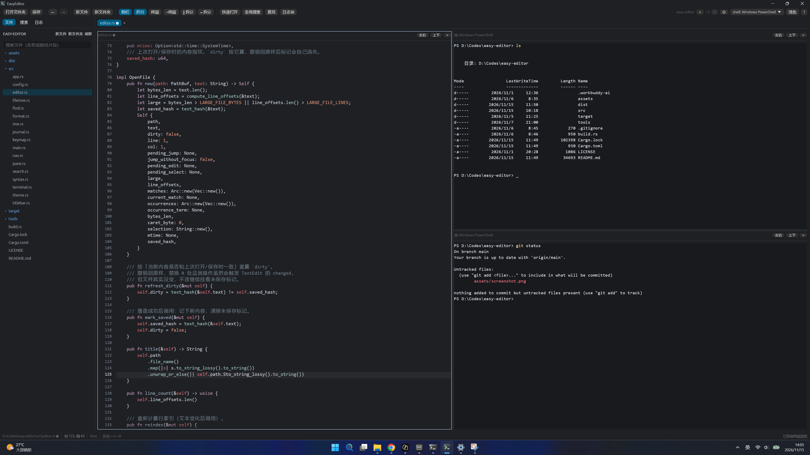

# EasyEditor

[English](README.md) | **中文**

一个用 **Rust + egui** 写的 Windows 桌面编辑器。功能不多，但每一样都能天天用：文件树、多终端、递归分屏、文本内工作日志块、能连 MySQL 的 SQL 块（结果就摆在正文下面）、光标位置前后跳转、全局搜索、查找替换、语法高亮，快捷键全部可改。

**当前版本** v0.3.0 ｜ **平台** Windows 10 / 11 x64 ｜ **许可** MIT

发布包是**单文件 exe**（约 12 MB，压缩后 5.2 MB），不需要 .NET、Electron 或任何运行时。

## 目录

- [核心功能](#核心功能)
- [快速开始](#快速开始)
- [使用方法](#使用方法)
- [配置](#配置)
- [技术栈](#技术栈)
- [代码结构](#代码结构)
- [构建、测试与打包](#构建测试与打包)
- [已知限制](#已知限制)
- [实现手记](#实现手记踩过的坑)
- [贡献与许可](#贡献与许可)

## 核心功能

| 功能 | 一句话 | 详见 |
|---|---|---|
| 代码编辑 | 行号、当前行高亮、syntect 语法高亮，长行可以折行也可以横向滚 | [#编辑](#编辑) |
| 多终端 | `portable-pty` 起真实 PTY，`alacritty_terminal` 做 VT 解析，能开好几块各跑各的 | [#终端](#终端) |
| 递归分屏 | tmux / i3 那套二分面板树，切多少次都行，默认键位和 Windows Terminal 一致 | [#分屏](#分屏) |
| 工作日志块 | 直接写在普通文本文件里的任务块，能和正文混排、跟着 git 走 | [#工作日志块](#工作日志块) |
| SQL 块 | 像 jupyter 那样：SQL 就写在普通文本文件里，`Ctrl+Enter` 跑，结果落在编辑器下面。`Ctrl+Alt+N` 直接开一个 `query-<时间戳>.sql`，连接已经绑好 | [#SQL-块](#sql-块) |
| 多个结果同时在屏 | 一条语句一个页签，第 2 条写错了不牵连第 1 条已经拿到的结果；页签栏切换着看，最多留 10 份；一批一个抬头，能弹成独立窗口，能复制成制表符分隔，能导 CSV，宽表横向滚，点行号选中整行，行首箭头在右边开详情窗口 | [#结果区](#结果区) |
| 多连接同时查询 | 每条连接一个后台线程，各跑各的语句；自动执行按连接各开各的闸，慢服务器拖不住另一条连接 | [#连接](#连接) |
| MySQL 连接 | 命名连接存在 config.json 里，按 连接 → 库 → 表 浏览，密码写 `env:` 让明文不落盘。启动一条都不连，`✓ 已连接` / `○ 未连接` / `⏳ 正在连接` / `✗ 连不上` 在连接出现的每个地方都看得见，右键或点卡片上的按钮连接、断开 | [#连接](#连接) |
| 手感 | 能点的地方光标都换成手形，按钮和行悬停时亮起，页签、行、格子各有各的浮窗说明 | [#界面交互](#界面交互) |
| 光标位置历史 | 像 IDEA 的 Navigate Back / Forward，光标停够 350ms 才算一个落脚点 | [#光标位置历史](#光标位置历史) |
| 查找替换 | 大小写、正则、全部匹配高亮、键盘不离输入框 | [#查找与替换](#查找与替换) |
| 全局搜索 | 优先 `rg --json` 流式显示，没有 ripgrep 就回退内置字节级扫描 | [#全局搜索](#全局搜索) |
| `.txt` 文件关联 | 启动时把自己登记进 Windows 的「打开方式」和「默认应用」列表，双击文件带进来就直接打开 | [.txt 文件关联](#txt-文件关联) |
| 选词高亮 | 鼠标选中一个词，全文所有相同词立刻标出来 | [#查找与替换](#查找与替换) |
| JSON / XML 格式化 | 只改内存里的 buffer，`Ctrl+S` 才落盘 | [#格式化](#格式化) |
| 中文输入法 | 新建对话框、编辑器正文、终端三处都能直接打拼音 | [#输入法](#输入法) |
| 中英文混排对齐 | 基线校正过，中文不会掉到行底 | [#中英文基线](#中英文基线) |
| 深浅主题 | 连 Windows 系统标题栏的底色和按钮字形一起刷 | [#系统标题栏得自己刷](#系统标题栏得自己刷) |
| 键位自定义 | `F1` 打开设置面板，点一下再按新组合即可，撞车会标红 | [#改快捷键](#改快捷键) |
| 配置持久化 | 字号、主题、终端偏好、改过的键位全存进 `%APPDATA%\easy-editor\config.json` | [#配置](#配置) |

## 快速开始

### 直接下载

到 [Releases](https://github.com/PBlueSky/easy-editor/releases) 页面下其中一个包，解压后双击 `EasyEditor/EasyEditor.exe`：

| 包 | 内容 | 适合谁 |
|---|---|---|
| `EasyEditor-<版本>-windows-x64.zip` | 单 exe + 中英两份 README + LICENSE | 大多数人 |
| `EasyEditor-<版本>-windows-x64-with-rg.zip` | 上面这些，外加 `rg.exe` 和 `THIRD-PARTY-NOTICES.txt` | 想要全局搜索跑满速 |

两个包都能用：没带 `rg.exe` 时全局搜索自动回退到内置扫描，只是大仓里慢一些。每个包旁边有同名 `.sha256.txt`，校验一下：

```powershell
Get-FileHash .\EasyEditor-0.3.0-windows-x64.zip -Algorithm SHA256
```

### 从源码跑

装好 Rust stable 工具链（`rustup`），然后：

```bash
git clone https://github.com/PBlueSky/easy-editor.git
cd easy-editor
cargo run --release       # 首次要编译依赖，之后很快
```

调试构建已经把依赖库设成 `opt-level = 2`（见 `Cargo.toml`），`cargo run` 也不卡。

```bash
cargo run -- D:\path\to\some-project    # 启动并打开某个文件夹
cargo run -- src\app.rs                 # 启动并打开某个文件
```

不带参数时的启动目录优先级：**命令行参数 > 当前目录像个工程（有 `Cargo.toml` 或 `.git`）> 上次打开的工作目录**。

## 使用方法

### 界面



```
┌──────────────────── 顶部工具栏（按钮排不下就换第二排）────────────────────────────────┐
├──────────┬────────────────────────── 中央：面板树（可递归拆分）─────────────────────┤
│ 侧栏     │  标签条 + 编辑器 / 终端面板…                                             │
│ 文件     ├────────────────────────── 底部：结果区（SQL）───────────────────────────┤
│ 搜索     ├────────────────────────── 底部：状态栏 + 查找替换条 ─────────────────────┤
│ 日志     │                                                                          │
│ 数据库   │                                                                          │
└──────────┴──────────────────────────────────────────────────────────────────────────┘
```

- **顶部工具栏**从左到右：`打开文件夹` `保存` `←` `→`（光标位置后退 / 前进）`新文件` `新文件夹` `侧栏` `折行` `终端` `+终端` `‖ 拆分` `═ 拆分` `快速打开` `全局搜索` `查找` `日志块` `数据库`，右边那组是 `深色` / `浅色`（切主题）、`?`（快捷键设置）、`shell:` 下拉、`⚙`（终端设置）、字号 `- 14 +` 和工作区名。`数据库` 是个下拉：最上面一行是当前默认连接（带上它那颗会话记号），往下是 `新建查询` / `插入 SQL 块` / `执行 SQL` / `结果区` / `本文件按 SQL 处理` / `连接管理…` / `侧栏数据库树`，整套数据库功能只多这一个按钮。
- **侧栏**四个页签：`文件`（文件树）、`搜索`（全局搜索结果）、`日志`（当前文件的日志块）、`数据库`（连接 → 库 → 表），`Ctrl+B` 显示或隐藏。
- 窗口拖窄到一排装不下时，剩下的按钮换到第二排继续排，不会挤成一团、也不会把字叠着画；右边那组换排后照旧从右往左钉。文件树那一行标题不能换排，用的是同一招：先按从右往左排完 `刷新` `新文件夹` `新文件`，再把剩下的那块矩形交给工作区名，名字只在这块里截断——以前长名字是直接压在「新文件」上面的。剩下不到 24 px 就干脆不画名字，绝不叠字；鼠标悬浮看完整路径。

### 文件树

`walkdir` 懒加载，默认隐藏 `.` 开头的条目。新建文件 / 文件夹有三个入口：工具栏按钮、文件树顶部按钮、任意条目的右键菜单；右键里还有「格式化」（只在文件上出现，且仅限 JSON / XML）、「重命名」（只在文件上出现）、「在资源管理器中显示」和「在此处打开终端」。根目录那一行的右键多两个开关：「显示隐藏文件」和「刷新」。

新建对话框弹出后输入框立刻拿到键盘焦点，直接敲文件名就行：`Enter` 创建、`Esc` 取消，不需要先点一下输入框。拼音 / 日文输入法也正常（见 [输入法](#输入法)）。

「重命名」的输入框就画在这个条目原来那一行上，预填当前名字，`Enter` 落盘、`Esc` 取消，点别处等于确认。名字里带 `/ \ : * ? " < > |`、或者空串、`.`、`..`、撞上已有文件的都不落盘，提示写在文件树底部。**已经在标签页里打开的文件会跟着换路径**，未保存的改动存盘时写进新名字，不会又冒出一个旧名字的副本；快速打开的索引也一起重扫。目录暂不支持改名。

「在此处打开终端」在焦点面板右侧切出一块新终端，shell 的工作目录就是这个条目所在的目录（点目录条目就是它自己），不动工具栏选的那个默认目录。

文件树顶部有**搜索框**：输入名称或相对路径片段就扫描整个工作区（跳过 `.git` / `target` / `node_modules` 等目录），大小写不敏感，最多列 500 条；点文件直接打开，点目录会展开到它在树里的位置并退出搜索。结果按查询串缓存，连续打字不会每帧重新遍历目录。

`Ctrl+P` 的「快速打开」走另一条路：工作区一打开就先建一份文件索引（上限 5 万条），输入按**子序列模糊匹配**打分排序，上下键选、`Enter` 打开。

配色跟 shell 里 `ls --color` 一个思路：目录蓝、可执行文件绿、普通文件正文色（具体色值见 [文件树配色](#文件树配色)）。

### 编辑

行号、当前行高亮、syntect 语法高亮、`Ctrl+S` 保存、未保存标记、关闭前确认。同时最多开 40 个标签。

长行有两种看法，用工具栏的**「折行」**或 `Alt+Z` 切换，选中的那种会存进配置：

- **不折行**（默认）：长行按原样排到面板外面，底下出横向滚动条。行号栏画在滚动区**外面**，滚多远都钉在左边不动。按住左键拖选时，指针靠近视口左 / 右边缘 28pt 以内会自动把正文往反方向推（每帧 14pt），选区能一路圈到屏幕外。
- **折行**：长行折进面板宽度，横向滚动条自己消失。一个逻辑行折成几个视觉行，行号和当前行底色跟着盖那几个视觉行，不会还按「一行一行高」往下排。

跳转（全局搜索、查找替换、日志块前后跳、光标后退 / 前进）滚的是「那一行」，横向位置不动，免得跳一次行把水平滚动位置甩掉。

字号用 `Ctrl` + `+` / `-`，只改编辑器和终端正文，不会把整个窗口一起缩放。

### 查找与替换

`Ctrl+F` 查找、`Ctrl+H` 替换，输入条固定在编辑区**底部**（状态栏上方）。键盘操作，不用离开输入框：

| 按键 | 在查找框里 | 在替换框里 |
|---|---|---|
| `Enter` | 下一个匹配 | 替换当前并跳到下一个 |
| `Shift+Enter` | 上一个匹配 | 上一个匹配 |
| `Ctrl+Enter` | — | 全部替换 |
| `Tab` | 切到替换框 | 切回查找框 |
| `Esc` | 关闭查找栏 | 关闭查找栏 |

支持区分大小写、正则（替换串可用 `$1` `$2`）、上下跳转、单个替换、全部替换；所有匹配都高亮，当前项用橙色区分。

**选词高亮**：鼠标选中一个词，全文所有相同词立刻用淡蓝底标出来（双击一次取整个词）。规则和查找栏一致——选中的词全小写就忽略大小写，含大写就精确匹配；选区正好覆盖一个完整单词时按词边界匹配，选 `id` 不会误标 `width` 里的 `id`；只圈到半截词（比如从 `foo_bar` 里选 `foo`）退回子串匹配。跨行、纯空白、超过 64 字符的选区不参与；命中封顶 2000 处，免得为一个单字母把全文扫穿。选词高亮和查找高亮是两套底色，叠在一起时查找优先。

### 全局搜索

`Ctrl+Shift+F`。优先调用 `rg --json` 并流式读取，边搜边显示；找不到 ripgrep 时回退内置扫描（`regex::bytes` + `memchr` 建行索引，跳过 `.git` / `target` / `node_modules` 等目录和二进制文件）。

结果统计显示命中数、耗时和用的哪个引擎，例如 `166 处结果 · 75 ms · ripgrep`。

- 「位置」列窄，长路径会截断成 `a_very_long_directory_…`，悬浮在这一格上会浮出**完整绝对路径**
- 拖动「位置」和「内容」之间的分隔线可以加宽列，宽度记在表格里保持住
- 点任意一格直接打开对应文件并跳到命中行
- 回车发起搜索，**只在这一帧焦点真在搜索框上**。回到正文之后回车就只是换行，输入法组字时的回车归候选词。焦点没离开搜索框时连按回车可以重跑一次，改完文件想刷新结果就用这个

### 工作日志块

不是独立的任务数据库，而是**写在普通文本文件里**的一种约定格式，可以和正文混排、跟着文件走、用 git 管理：

```
===================================================工作日志1 2026-11-01 13:09 [待处理]
1、一段文字内容
2、一段文字内容

===================================================工作日志2 2026-11-01 13:10 [已完成]
1、一段文字内容
```

头部 = 51 个 `=` + 标题 + 空格 + `YYYY-MM-DD HH:MM` + 空格 + `[状态]`。

- `Ctrl+J`（或顶栏「日志块」按钮、侧栏「日志」页签里的插入按钮）在光标处插入一个新块，光标落在 `1、` 后面，紧接着就能打字；插入后视图**留在原地**，文件里有大量折行长也不会被甩回顶部
- `Ctrl+Alt+↑` / `Ctrl+Alt+↓` 在块之间前后跳转
- `Ctrl+Alt+D` 切换当前块的 `[待处理]` ↔ `[已完成]`
- 侧栏「日志」页签列出当前文件的所有块，点击跳转

### SQL 块

同一套约定挪到查询上，存下来的 SQL 就还是个普通文本文件。头部本身是一条合法的 MySQL 注释，整个文件原样管道给 `mysql` 客户端也照跑：

```text
-- sql 活跃用户 2026-11-15 14:03 [待执行] conn=demo
SELECT id, name FROM users
WHERE status = 1
LIMIT 50;
```

头部 = `-- sql` + 标题 + `YYYY-MM-DD HH:MM` + `[状态]` + 尾部键。目前认两个尾部键：`conn=<名字>` 把这块绑到某个命名连接，光一个 `auto` 表示允许自动执行。尾部认不出的字段一律忽略，以后加字段不会把老文件顶坏。

- `Ctrl+Alt+N`（或顶栏 `数据库 ▸ 新建查询`，或文件树里右键某个目录 `新建 SQL 查询`）建一个 `query-20261115-140312.sql`：里面已经有一块绑好默认连接的空块，建完直接打开，光标停在块头下面那一行。同一秒里连按两次会加成 `-2`，不会把刚建的那个盖掉
- `.sql` 文件打开就带 **SQL 模式**；别的文件在顶栏 `数据库 ▸ 本文件按 SQL 处理` 里手动开。模式跟着标签走、不写进文件：开了之后正文按 SQL 上色，也才允许跑「没有块」的整份文件
- `Ctrl+Enter` 跑的是**有选区就跑选区；没选区就只跑光标所在的那一句**（在块里、SQL 模式下在整份文件里，按分号切出这一句），状态栏写成 `已提交 n 条语句到「本机」（第 2/3 句）`，交出去的是哪一截一目了然。要把**整块**交出去用 `Ctrl+Shift+Enter`
- `Ctrl+Shift+J`（或顶栏 `数据库 ▸ 插入 SQL 块`）在光标处插入一块，今天的日期时间和默认连接已经填好
- 拆句用的扫描器认得 `'…'` `"…"` `` `…` `` `--` `#` 和 `/* … */`，字符串或注释里的分号不会把一句话劈成两半；面板标题和字节区间出自同一个扫描器，所以两边永远对得上
- **整块**（`Ctrl+Shift+Enter`）跑完（每条语句都回了回执）才把头部状态从 `[待执行]` 改成 `[已执行]` / `[失败]`。按 `Ctrl+Enter` 只跑一句时故意不动块状态——块里的一句跑完不等于整块跑完，分两条键就是为了这件事说得准
- 被服务器拒掉的语句会在**文件正文里**铺一层半透明红底，一眼就看到该改哪句，不用去数面板。铺之前先拿原文验一遍区间（字节已经对不上这条语句的标记直接丢掉，不猜位置），头部回写让整块变短时它跟着平移，一打字就清掉
- `Ctrl+Shift+R` 显示 / 隐藏结果区，顶栏 `数据库 ▸ 结果区（n）` 是同一件事

### 结果区

**一条语句一个页签**，最多 10 份同时在册。分面板是因为：块里三条 `SELECT`，第二条写错了，第一条的结果也还值得看，不该陪着报错一起丢掉；排在失败语句后面的那些标成 `未执行`，不会一直转圈。挤掉的总是最老的那一份。

十条一起摊在底下会把编辑器挤没，所以上屏的只有一页：页签栏一格一条语句，写成 `3·SELECT name FROM u`，左边一颗状态点（绿=成功、红=失败、蓝=还在等、灰=未执行），右边一格 `✕` 单关这一份。点页签只看这一份，其余的留在册上不占地方；关掉当前那份就自动落到列表里第一份，不会出现「谁都没指着」的空结果区。

- 页签太长会截断（26 个字符），鼠标悬上去给完整语句加这轮的耗时行数；一次执行超过一屏页签时，页签栏自己横向滚
- 批次那一行仍然在页签上方：`14:03:12  本机 · 「查用户」 · 共 3 条`，两个块跑出来的语句长得像的时候，只有时间戳说得清哪批是哪批
- 面板标题里的 **`1/3`、`2/3`、`3/3`**，切着看也知道这是这块的第几条

- 每个面板的标题条上有 `回块`（跳回它来自哪个块）、`放大` / `收起`（把**这一个**结果放进独立的可拖窗口——底部那一条拉不开的宽表就靠它看）、`复制`（整份结果按制表符分隔进剪贴板，粘进表格软件直接分列）、`导出`（CSV）、`关掉整块`（关掉这次执行的所有页签）和 `✕`
- 网格里每格都是单行截断——宽表这样才看得下去；右键任意格子能复制单元格 / 整行 / 整表
- **列多的宽表横向滚得动**。`egui_extras` 的表体只给竖向滚动条，所以整块网格外面自己套了一层横向滚动区，表头和表体一起滚，列不会错开。每列起手 140 pt、下限 56 pt、照样能拖着改宽；`#` 那一列 46 pt，跟着一起走。这么套有一个已知代价：表格自己的竖向滚动条现在落在**内容**的右边缘，往右滚到底时它可能在屏外，滚轮上下滚照旧好使
- **行首那个 `▸` 在屏幕右边单独开一个窗口**看这一行：一格一行，写成 `列名 = 完整值`，可换行、可选中，底下带 `复制整行`。同一个 `▸` 再点一下就收掉；一个面板只开一个这样的窗口，收掉再开还回到原来那个位置。以前是把它摊在表格底下，那一块既收不回去，又老被表格自己的视口裁掉，所以才搬出去
- **这个窗口默认点别处就关**：往页签、别的格子、编辑器里任何一下点击，它就自己收掉，不用回去找那个 `✕`。右上角的 `钉住` 勾上以后这条就不成立了——对着几行来回比的时候钉住，换行也不会把它关掉；钉住的状态跟着「这一份结果」走，切页签再切回来还在
- **点行号选中整行**。这一行每格都铺上选中底色，表格底下跟出一排按钮：`复制整行`（这一行按制表符分隔）、`看详情`（右边那个独立窗口）和 `取消选中`。拷贝故意放在这排按钮上而不是 `Ctrl+C`——那一下归编辑器，结果区抢过去会把用户正打算拷的那段文字换掉
- 真被列宽裁掉的那一格，鼠标悬上去给出内容的开头一段；**双击它把这一格单独开一个窗口**——换行、可滚动、整段选中，窗口里的 `复制本格` 拷的是**没截断的原文**（右键菜单里同一件事叫 `查看完整内容`）。窗口读的就是这个面板的数据，不存在两份结果。这一格的小窗和行详情一样：点别处自动收，也能钉住
- 什么都没跑的时候底部那条也能拖宽：以前空结果区只量到一行小字，往上拖它就立刻回弹成默认高度
- 底栏上有 `全部收起 / 全部展开`、`清空`（关掉跑完的，还在等回执的留着）和 `关闭`
- 查询回的是 `连接 · N 行 · M ms`，下面是一块可滚动的网格——结果区给它 120 pt，放大窗口按它要多高给多高。写操作回 `影响 N 行 · M ms`，服务器报了最后插入 id 和警告数就一并带上
- 超过 1000 行**故意**截掉并标上 `（截断）`：一个忘了写 `LIMIT` 的大表不该把一个线程和几百兆挂在侧边面板上。只读语句还带一个 30 s 的服务器端上限，连接带 5 s 的 TCP 超时，主机那一栏写错不会挂两分钟

`导出` 写的是 RFC 4180 CSV：CRLF 换行，含 `,` `"` CR LF 的字段加引号、内部引号翻倍，`NULL` 落成空字段，BLOB 写成小写十六进制，开头塞一个 UTF-8 BOM 让 Excel 认中文。会被 Excel **执行**的字段——以 `=`、`@`、制表符开头，或者 `+` / `-` 后面跟的不是数字——刻意加一个 `'` 前缀；真正的负数保持数字。文件名取块标题（非法字符替掉），取不到就退回 `result_<id>.csv`。

### 自动执行

头部写上 `auto` 就可以停手：最后一次按键 700 ms 后这块自己跑一遍，这就是需求里 jupyter 的那一半。三道闸口保证它不咬人：

- 只认标了 `auto` 的块，而且**正文里每条语句都得是只读的**——`INSERT` / `UPDATE` / `DELETE` / `DROP` 这些不管头部怎么写都不会自己跑
- 一份正文只跑一次：（块, 正文）这一对会记下来，想再跑得先改 SQL，没有轮询
- 这条连接还在等回执时不再往它身上提交新的一批，慢服务器堆不出好几批；闸按连接分，所以另一条连接慢成这样时，这块照旧会跑

写操作仍然得人亲手按 `Ctrl+Enter`。

### 连接

数据库相关的都挂在顶栏那一个 `数据库` 下拉上——插块、跑块、结果区、连接管理、侧栏库表树。

**`数据库 ▸ 连接管理…`**（窗口标题「数据库连接」）列出存下来的每条连接：`新建` 加一条，点某一行进去改，`删除` 去掉，表单里的 `测试连接` 会真去开一次服务器并把版本读回来。改名会把新旧两个名字的缓存树和后台线程一起清掉，默认标记跟着留在改名后的连接上——但块头还写着 `conn=旧名` 的那些**不会**跟着改，记得连头部一起改。一条连接就是 `名称` / `引擎` / `主机` / `端口` / `用户` / `密码` / `默认库`，原样存进 `config.json`：

```json
{
  "db_connections": [
    {
      "name": "demo",
      "kind": "mysql",
      "host": "127.0.0.1",
      "port": 3306,
      "user": "root",
      "password": "env:DEMO_PW",
      "database": "shop"
    }
  ]
}
```

`password` 支持 `env:VAR`：真正打开连接时先查 `VAR`，查不到再查 `EASY_EDITOR_VAR`，配置文件因此不必装着密码。直接写明文也行——只是要记得 `config.json` 对你这个 Windows 账号可读。

**连上了没有，现在是明着说的。** 这件事以前的答案是「你点过 `测试连接` 之后，按钮边上一行 11 号灰字」，在这一屏上约等于没说。现在连接出现在哪儿，那颗记号就出现在哪儿，而且说的是**会话现在挂不挂着**，不是某次测试的历史结论：

| 记号 | 含义 |
| --- | --- |
| `○ 未连接` | 没跟这台服务器说过话。**启动时每条连接都在这一档** |
| `⏳ 正在连接…` | 已经发出去了，答案在路上——TCP 握手 + 首包最多挂 20 s，挂过就自己翻成 `✗` |
| `✓ 已连接 · 8.0.33` | 会话真挂着，版本读回来了 |
| `✗ 连不上 · 2003 …` | 服务器原话，可选中，直接抄去查 |
| `⚠ 配置改过了` | 会话有过，但它当初建立时那份主机 / 端口 / 用户 / 密码 / 库名已经被改掉了 |

**不再一打开程序就把所有连接全连上。** 配了 10 条只使其中 2 条的话，另外 8 条不该各占一个线程、各敲一次 TCP。启动时一条都不碰（`startup_connects_nothing` 把这件事钉成了测试），要会话只有三条路：侧栏那行点 `连接`（或右键 `连接`）、表单里点 `测试连接`、或者什么也不点直接 `Ctrl+Enter`——SQL 真要发出去时它自己会把这条连上。侧栏底下写 `已连接 2 / 10`，一眼知道现在挂着几条。

会话也不会一直挂着：一条连接闲够 5 分钟（`IDLE_LINK`），回收把它的线程收掉，记号回 `○ 未连接`；正在跑语句的那条不动。手工 `断开连接` 立刻收线程和缓存树，状态栏说一句「下次执行会自动重连」。服务器把会话掐了（`2006` / `2013` / `2055`）标记跟着翻成 `✗`，下一次执行重连；纯 SQL 语法错不算断线——服务器答了话，会话照旧能用。

「连接」和「已连接」是两件事：记号只按配置指纹认领（`ConnectionSpec::stamp()`），改一个字段那个 `✓` 当场变 `⚠`，因为从那以后根本没跟服务器说过话；改名会把线程一起换掉，所以牌子退回 `○ 未连接`，重新连上才重新亮起。删掉的连接留下的结论直接丢掉，不会换个人接着戴。

**多连接同时查询是真的同时。** 每条连接一个自己的后台线程，`Ctrl+Enter` 发出去的语句按 `(连接, 语句 id)` 回来，所以甲连接在跑一条三分钟的报表，不挡乙连接立刻回你一句 `SELECT 1`。侧栏连接行右侧的 `⏳N` 是这条连接现在排了几条没回。自动执行也跟着按连接分闸：只有**同一条连接**上还挂着没回的回执时才憋住下一批，别的连接慢不慢跟这块无关。

**`数据库 ▸ 侧栏数据库树`** 打开 `数据库` 页签：连接 → 库 → 表，每一层第一次展开时才去取，失败那一行上有 `重试`。双击表名复制它的限定名，表名的右键菜单还能直接复制一条写好的 `SELECT * FROM 库.表 LIMIT 100;`。

这棵树现在是三列意思，不是一堆文字：最左一列只有 `▸` / `▾`（它只管展开收起，点它绝不会改动 SQL 发往哪儿），中间一列每层一个记号（`◆` 连接、`▤` 库、`▦` 表），选中那行的记号换成强调色，最后一列是名字。整行都是按钮，点得到的是「这一行」而不是那十几个像素的字；选中的那行铺底色，不再靠一个主题本来就在别处用着的颜色暗示。

「SQL 发去哪儿」由两行分别回答，而且各答各的：

- **连接**——点它的名字就把它设成默认，块头没写 `conn=` 的都往它去
- **库**——点它的名字就把它认作**这条连接的当前库**，覆盖 `config.json` 里那个 `database` 字段。不写盘：这是本次会话的选择，发出去的 spec 由 `effective_spec()` 现拼，树上的灯、状态栏的尾巴和真正连上去的库因此只能是同一件事

两件事都写在页签最上面那个框里——`默认连接 demo · root@127.0.0.1:3306` 和 `当前库 shop`。只写连接不写库的树，等于把半个答案藏起来。

框里还有第三行：`已连接 2 / 10`——配了几条、此刻真挂着几条，一眼分得清。没连的那几条右侧摆一颗 `连接`，点它当场发起握手；连着的摆 `断开连接`。这颗按钮刻意不藏在右键里：状态说了「还没连」，就得同时说「点这里能连」，不然用户只能自己猜方法。右键菜单里同样有这条，还会跟着状态换字。

**SQL 发去哪儿永远不用猜。** 这件事同时写在三个地方：页签顶上那个 `默认连接` / `当前库` 卡片（上面刚说过）、连接行右侧的 `默认` 牌子、以及当前文件跟 SQL 有关时状态栏上的 `SQL → demo ✓` 小尾巴（点它直接跳到侧栏数据库树；文件里块头写了 `conn=`、或树上换过当前库时，尾巴会把真正去的那个库带上）。一条都没点过时，默认就是 `config.json` 里的第一条，牌子上显示的也是它——显示走的是 `active_conn()`，和 `Ctrl+Enter` 问的是同一个函数，两边不可能说两套话。

**再加一种引擎**本该是个小改动：`src/db/mod.rs` 是引擎无关的协议（spec → driver，语句进、事件出），`src/db/mysql.rs` 是唯一认识 MySQL 的文件。接一个新数据库就是加一个 `DbKind` 变体、在 `connect()` 里加一个分支、再写一个驱动模块——块解析、结果区、CSV 那几层都不动。所有活都在每条连接各自的后台线程上跑，靠 channel 回报；这个程序没有 async 运行时，这个功能也不会给它添一个。

### 界面交互

鼠标指到哪儿，哪儿就该说清「这一下有用」。这一轮把这件事铺满了整个程序：

- **能点的地方光标都变手型**。按钮、复选框、页签、树行、搜索结果的每一格、文件树每一行、面板标题、待办块标题——手型不是稀罕事，浏览器和 VS Code 都这么做。实现分两层：egui 自带的 `visuals.interact_cursor` 全局打开，所有 `Button` 系（含 `small_button` 和行内小按钮）跟着变；自己画矩形的那些（结果页签、侧栏树行、文件树行、行详情窗口的 `钉住`）不吃这条全局设置，逐个挂 `on_hover_cursor(HAND)`
- **悬停就亮，不占地方**。行内那些看着像文字、其实能按的小按钮（`回块`、`放大`、`复制`、`导出`、侧栏的 `连接` / `断开连接`）用 egui 的「没激活就藏边框」：底色只在悬浮和按下时出现，边距一直在，所以点下去不会把整行推歪
- **整行都是按钮**。侧栏的连接 / 库 / 表、文件树的目录和文件，点名字那一行任何一处都算选中这一行——不用去瞄那十几个像素的字；左边那一列 `▸` / `▾` 只管展开收起，绝不会顺手改动 SQL 发往哪儿
- **每处 hover 都有一句话**。页签给完整语句 + 行数 + 耗时，格子给没截断的开头一段，树行给「点名字 / 点箭头 / 右键」各是什么，状态栏那个 `SQL → …` 尾巴告诉你这一下会发到哪台库去

### 终端

`Ctrl+`` ` 聚焦终端面板（没有就新开一块），`Ctrl+Shift+`` ` 直接新开一块。文件树里右键某个目录（或目录里的文件）选「在此处打开终端」，新面板的 shell 直接开在那个目录里。

终端不是单独的底部面板，而是和编辑器一样是**面板树里的一块**：默认切在当前面板右侧，可以同时并排好几块，各跑各的 shell。顶部工具栏的 `shell:` 下拉框选的是「下一个新建终端用哪个 shell」，自动检测本机可用的 PowerShell 7 / Windows PowerShell / 命令提示符 / Git Bash / WSL；已经开着的终端不受影响。

终端有焦点时，`Tab`（补全）、方向键（历史 / 光标移动）、`Esc` 都由终端自己处理，不会被 egui 拿去切换控件焦点。鼠标拖选文字后：

- `Ctrl+C`：有选区就复制，没有选区照常发送中断（`^C`）
- `Ctrl+V`：粘贴
- `Ctrl+Shift+C` / `Ctrl+Shift+V`：复制 / 粘贴（与 Windows Terminal 一致）
- 右键菜单里也有「复制」「粘贴」，`Ctrl+Insert` / `Shift+Insert` 同样可用

选区按绝对行坐标记录，滚动回滚历史后仍指向原来的文字；复制中文等宽字符时不会把占位格算进去，行尾空白会裁掉。

回滚历史：鼠标滚轮**一格 3 行**（走原始滚轮事件，触控板按 14 px 一行折算），只要有过期输出，面板右缘就有一条悬浮滚动条，拖滑块、单点轨道、滚轮都能用；它画在文字之上，不占排版宽度。往上翻过历史之后屏幕会钉在旧内容上（alacritty 的行为），此时只要敲一下键盘（粘贴进来的字符也算），视图就自动归位到最新一行。

自动探测不一定找得到（比如 Git Bash 没进 PATH）。工具栏 `⚙` 打开「终端设置」，给选中的 shell 单独指定**程序路径**和**启动参数**，留空就回到自动探测 / 内置参数，改动直接写进 `config.json`：

```json
{
  "terminal_shell": "gitbash",
  "terminal_programs": { "gitbash": "C:/Program Files/Git/bin/bash.exe" },
  "terminal_args": { "gitbash": "-l" }
}
```

种类 id 是 `pwsh` / `powershell` / `cmd` / `gitbash` / `wsl`；`terminal_args` 用空格分隔，带空格的参数用双引号包住。

### 分屏

中央区域是**一棵递归的二分面板树**，思路来自 tmux / i3：每块面板要么在看文件，要么在跑 shell，任意一块都能继续往右或往下切一刀，所以「左边写代码、右上一个终端、右下一个终端」是常态。

默认键位**和 Windows Terminal 一致**：

| 按键 | 作用 |
|---|---|
| `Alt+Shift+D` | 自动拆分：当前面板宽就左右切、高就上下切，切完两块都更接近方形 |
| `Alt+Shift++` / `Alt+Shift+-` | 向右 / 向下拆分 |
| `Alt+←↑↓→` | 按几何位置聚焦左 / 上 / 下 / 右那块面板 |
| `Ctrl+Shift+W` | 关闭当前面板（最外面那块不会被关掉，只退回空白面板） |
| `Ctrl+Shift+Tab` / `Ctrl+Alt+Shift+Tab` | 循环聚焦下一块 / 上一块 |

拆的是**当前聚焦的那块面板**。编辑面板拆出来的新面板显示同一个文件，方便左右对比；终端面板拆出来的直接是一个新 shell。

- 每块面板顶部有自己的标题条（文件名 + 未保存标记，或 `⌨ shell 标题`），右侧三个小按钮：`左右` `上下` 拆分、`×` 关闭
- 右键标题条可以把这块面板**移到工作区最右 / 最左 / 最上 / 最下方**
- 分割线可拖动，比例按当前像素换算，限制在 5%~95%
- 鼠标点在哪块面板上就聚焦哪块
- 标签是全局的（和 VSCode 一样）：关掉一块面板不会关掉标签，同一个标签也能同时出现在几块面板上，标题条上标 `×2`

> 和 WT 一样，`Alt+←` `Alt+→` 这些键在全局快捷键层就被吃掉了，不会转发给终端。Git Bash / WSL 里习惯用它们跳词的话，在 `F1` 里把 `focus_pane_left/right` 改成别的键或留空解绑。

### 光标位置历史

像 IDEA 的 Navigate Back / Forward：`Ctrl+Alt+←` 回到上一个停留过的位置，`Ctrl+Alt+→` 再往前走。

不是每按一下方向键就记一条——光标在某个位置**停够 350ms** 才算一个落脚点，这样连按方向键扫过十几行不会把历史刷爆。同一行里左右挪光标只更新偏移、不新增条目。历史上限 200 条，在历史中间又走了新路时后面的分支作废（和浏览器一致）。状态栏显示 `历史 ←3 →1`，工具栏的 `←` `→` 按钮也能点。

### 格式化

`Alt+Shift+F` 格式化**当前面板里的整个文件**：直接在 buffer 上改、标成未保存，按 `Ctrl+S` 才落盘，不会新开面板或新标签。文件树右键的「格式化」对 JSON / XML 有效：已打开的文件走上面这条路径，没打开就原地读、格式化、写回。支持 JSON（`serde_json`）和 XML（轻量 token 流缩进），按扩展名或内容特征判断格式；只读预览的大文件会明确拒绝而不是静默失败。

### 输入法

拼音 / 日文这类输入法在**新建文件对话框**、**文件树里的改名框**、**编辑器正文**、**终端**这几个地方都能正常打字。对话框和「快速打开」只在输入框真的没焦点时才要焦点（要焦点会顺手打断组字），组字期间的 `Enter` / `Esc` 归输入法（确认候选词 / 撤销组字），不会被误当成「创建文件」；快速打开的上下键同样让位给候选词翻页。终端那边则要把光标格作为输入法锚点报给系统，选定后的整串中文原样写进 PTY——不报锚点的话系统压根没把输入法关联到这个窗口。

### 快捷键一览

全部可在 `F1` 里改，下表是默认值。

| 快捷键 | 功能 |
|---|---|
| `Ctrl+O` | 打开文件夹 |
| `Ctrl+S` / `Ctrl+Shift+S` | 保存 / 全部保存 |
| `Ctrl+P` | 快速打开文件 |
| `Ctrl+Shift+F` | 全局搜索 |
| `Ctrl+F` / `Ctrl+H` | 当前文件查找 / 替换 |
| `Ctrl+Alt+←` / `Ctrl+Alt+→` | 光标位置后退 / 前进 |
| `Ctrl+N` / `Ctrl+Shift+N` | 新建文件 / 新建文件夹 |
| `Ctrl+J` | 插入工作日志块 |
| `Ctrl+Alt+↑` / `Ctrl+Alt+↓` | 上一个 / 下一个日志块 |
| `Ctrl+Alt+D` | 切换日志块完成状态 |
| `Ctrl+Alt+N` | 新建查询文件（`query-<时间戳>.sql`，首行块头已绑好默认连接） |
| `Ctrl+Shift+J` | 在光标处插入 SQL 块 |
| `Ctrl+Enter` | 执行选中的那段；没选区就只跑光标所在的那一句（按分号切）；SQL 模式下两者都没有就从整份文件里切这一句 |
| `Ctrl+Shift+Enter` | 把整块（SQL 模式下没有块就整份文件）交出去执行，跑完回写块状态 |
| `Ctrl+Shift+R` | 显示 / 隐藏结果区 |
| `` Ctrl+` `` | 聚焦终端面板，没有就新开一块 |
| `` Ctrl+Shift+` `` | 新建终端面板 |
| `Ctrl+B` | 显示 / 隐藏侧栏 |
| `Ctrl+W` | 关闭标签 |
| `Ctrl+Shift+W` | 关闭当前面板 |
| `Ctrl` + `+` / `-` | 字号（只动编辑器和终端正文） |
| `Alt+Z` | 切换自动换行 |
| `Alt+Shift+D` | 自动拆分当前面板 |
| `Alt+Shift++` / `Alt+Shift+-` | 向右 / 向下拆分 |
| `Alt+← / ↑ / ↓ / →` | 聚焦左 / 上 / 下 / 右侧面板 |
| `Ctrl+Shift+Tab` / `Ctrl+Alt+Shift+Tab` | 下一个 / 上一个面板 |
| `Alt+Shift+F` | 格式化（JSON / XML，只改 buffer） |
| `F1` | 快捷键设置 |
| `F12` | 截图，存到 `%APPDATA%\easy-editor\screenshot.bmp` |

### 改快捷键

`F1` 打开设置面板，点一下组合键，然后直接按下新的组合即可。

- `Esc` 取消录制，`Backspace` / `Delete` 解绑该动作
- 撞车会标红提示「与「xxx」冲突」
- 每项可以单独「重置」，也可以「全部恢复默认」
- 只把改过的项写进 `config.json`，以后加新动作不会破坏老配置

### .txt 文件关联

Windows 上启动时会把自己登记成能打开 `.txt` 的程序，于是两条路都通：

- 右键 `.txt` → **打开方式** → **选择其他应用** → EasyEditor（在那里勾上「始终」就固定下来了），或者
- **设置 → 应用 → 默认应用 → EasyEditor → `.txt`**

登记只写 `HKCU\Software\Classes`——当前用户、不需要管理员、不动机器级设置。它刻意**不**去抢默认处理器：那份值叫 `UserChoice`，由系统哈希保护。第三方程序算不出这个哈希，写错了也不只是白写——Windows 一旦发现哈希不对，会把整条关联判废，这个文件类型连图标和默认程序都留不住。所以「设为默认」这一下得你自己点，程序不会把你已经选好的东西悄悄换掉。

这个行为由 `config.json` 里的 `txt_association` 控制（默认 `true`）。不想让这个 exe 出现在列表里就改成 `false`——典型场景是 `target\debug\` 下的开发构建，它下一次 `cargo clean` 就没了，却已经在「打开方式」里留了个指向空位的条目：

```json
{ "txt_association": false }
```

写进去的键都带自己的名字（`EasyEditor.txt`、`Applications\<exe 文件名>`、`Clients\TextEditor\EasyEditor`，外加 `RegisteredApplications` 里的一行），事后想清掉就是删这几处，和别的编辑器不共用任何一键。真建新键时会补一声 `SHChangeNotify(SHCNE_ASSOCCHANGED)`，所以右键菜单当场就有，不用等注销重登。双击打开也照预期工作：文件路径作为第一个参数递进来，EasyEditor 直接把它打开。

## 配置

字号、深浅主题、侧栏展开状态、侧栏页签、是否显示隐藏文件、是否折行、`.txt` 关联开关、上次打开的工作目录、终端偏好、数据库连接、改过的快捷键，都自动存到 `%APPDATA%\easy-editor\config.json`，下次启动原样恢复；没写的字段走默认值（`word_wrap: false` 即长行横向滚动，`txt_association: true` 即启动时登记 `.txt` 关联，`db_connections: []` 即一条连接都没有）。写盘有 600ms 防抖（拖字号时不会狂写磁盘），退出时再补一次。

```json
{
  "font_size": 14.0,
  "dark": false,
  "last_workspace": "D:/Codes/demo",
  "keymap": {
    "nav_back": "Alt+Left",
    "terminal_toggle": ""
  }
}
```

`keymap` 里只记和默认值不一样的项，可以手改。空串表示主动解绑；组合写法是 `Ctrl+Alt+Shift+键名`，键名大小写不敏感，方向键写 `Left`/`Right`/`Up`/`Down`，其余用 `Enter`、`Tab`、`Esc`、`F1`、`Backtick`、`Plus`、`A`、`0` 这种。

**这文件读不出来时会怎样**

手改 JSON 很容易碰坏一个引号、写错一个枚举值（比如 `db_connections[].kind` 只认 `"Mysql"`，小写不行）。这种时候应用按默认值启动，但**不会**把默认值直接盖回你的文件：

- 原文件整份改名成 `config.json.broken` 留在同一目录（已经有 `.broken` 就往后加序号，不覆盖上一次的留档），然后照默认值启动；
- 屏幕正中弹一个窗，写清楚是哪儿卡住的（serde 的原话带行列号）、留档在哪、可以复制路径；点「知道了」才收，收掉之后保护还在；
- 如果连留档都没改成（比如目录不可写），或者文件根本读不出内容，那这次启动**全程不落盘**：你在界面里改的字号、加的连接到退出都不会写，直到你自己把那份文件弄对。宁可丢这一次的改动，也不覆盖你手写的配置。

0 字节的 `config.json` 按「还没配过」处理，不算写坏，也不会弹窗。

**可选环境变量**

| 变量 | 作用 |
|---|---|
| `EASY_EDITOR_RG` | 指定 `rg.exe` 的完整路径。不设的话先在 PATH 里找，再找本程序同目录；都没有就用内置扫描 |
| `EASY_EDITOR_SHOT=1` | 启动后自动截一张图（调试用） |
| `EASY_EDITOR_VERIFY=<脚本>` | 启动后自动跑一段脚本并截图：`split` / `word` / `nav` / `enter` / `keys` / `findflow` / `insert` / `replace`（调试用，旧前缀 `CODE_EASY_*` 仍兼容） |

## 技术栈

| 用途 | 库 |
|---|---|
| 窗口框架 | `eframe` 0.37（关掉默认 wgpu，走 `glow` 后端） |
| UI | `egui` 0.37 / `egui_extras` 0.37 |
| 代码高亮 | `syntect` 5.3 |
| MySQL 客户端 | `mysql` 28，把默认的 `derive` 和 C 压缩后端都关掉——每条查询都只是工作线程上一次同步调用，所以整个程序里没有 tokio |
| 文件树 | `walkdir` 2.5 |
| 终端 | `alacritty_terminal` 0.26 + `portable-pty` 0.9 |
| 全局搜索 | 外部 `ripgrep` 二进制，缺失时回退 `regex` 1 + `memchr` 2 的内置扫描 |
| 中文宽度 | `unicode-width` 0.2 |
| 配置 / 序列化 | `serde` 1 + `serde_json` 1 |
| 时间戳 | `chrono` 0.4 |
| 原生文件对话框 | `rfd` 0.15 |
| Windows 标题栏配色 | `raw-window-handle` 0.6 + `DwmSetWindowAttribute` |
| `.txt` 关联 | `advapi32` 的 `RegCreateKeyExW` / `RegSetValueExW`，和标题栏那几处一样手写声明，不引注册表 crate |
| exe 图标与属性页 | `winresource` 0.1（build 依赖） |

界面全部是即时模式 GUI：没有 QSS / CSS，没有 webview，控件状态存在 `egui::Id` 关联的 state 里。渲染走 glow（OpenGL），重绘是按需的——没有终端在跑、也没有光标在闪的时候，静止的界面不再画新帧。

## 代码结构

约 21600 行 Rust，单个 binary crate，23 个源文件：

| 文件 | 职责 |
|---|---|
| `src/main.rs` | 入口、`windows_subsystem`、窗口构建与图标 |
| `src/app.rs` | 应用主体：布局、快捷键、打开 / 保存、全局搜索、查找替换、日志块、终端调度、SQL 提交、逐标签的 SQL 模式与新建查询 |
| `src/pane.rs` | tmux 风格的递归二分面板树（`Leaf` / `Split`），只管布局不管内容 |
| `src/editor.rs` | 编辑器控件：行号 + 高亮 + 编辑 + 跳转 + 大文件只读虚拟渲染 + 覆盖层绘制 |
| `src/terminal.rs` | PTY 读写、VT 解析、键盘鼠标事件路由、选区与滚动条 |
| `src/filetree.rs` | 目录树、懒加载、文件搜索、类型配色 |
| `src/find.rs` | 当前文件内查找替换（匹配位置统一用字节偏移） |
| `src/search.rs` | 全局搜索：ripgrep 优先，内置扫描兜底 |
| `src/journal.rs` | 工作日志块的解析与插入 |
| `src/sql.rs` | SQL 块的纯文本层：扫描与构造块、拆句**并给出字节区间**、按一个字节偏移找出它落在哪一句、判断是否只读。既不碰数据库也不碰界面 |
| `src/database.rs` | 侧栏「数据库」页签和连接管理窗口：缓存树、在路上的请求、连接草稿，以及按指纹认领的测试结论 |
| `src/db/mod.rs` | 引擎无关的协议：`ConnectionSpec` → `Driver`，一条连接一个后台线程，事件回报，外加一个 `MockDriver` 让界面不连服务器也能测 |
| `src/db/mysql.rs` | 唯一认识 MySQL 的文件：连接参数、文本协议 → 单元格、一次调用跑一条语句 |
| `src/results.rs` | 底部结果区：一条语句一个面板、批次抬头、独立放大窗口、状态回写、`复制` 的制表符文本、`导出` 的 RFC 4180 CSV、横向滚动、整行选中、行详情独立窗口 |
| `src/nav.rs` | 光标位置历史 |
| `src/format.rs` | JSON / XML 格式化 |
| `src/keymap.rs` | 可配置快捷键：动作 id、序列化、冲突检测 |
| `src/config.rs` | 配置读写与防抖 |
| `src/theme.rs` | 字体、配色、中英文基线推导 |
| `src/syntax.rs` | syntect 高亮，按行缓存成 egui 着色片段 |
| `src/ime.rs` | 输入法组字状态判断、锚点处理 |
| `src/titlebar.rs` | 系统标题栏配色（仅 Windows） |
| `src/assoc.rs` | `.txt` 关联：要写的注册表值先摊成一份纯数据清单（不动这台机器的注册表也能审），再交给一层很薄的 `advapi32` 调用写下去 |

## 构建、测试与打包

### 日常命令

```bash
cargo check                             # 只做类型检查，最快
cargo test                              # 235 个单元测试
cargo build                             # 调试构建 → target/debug/easy-editor.exe
cargo build --release                   # 发布构建 → target/release/easy-editor.exe
cargo clippy --all-targets              # 需要 rustup component add clippy
cargo fmt --check                       # 需要 rustup component add rustfmt
```

发布构建走 `windows_subsystem = "windows"`（见 `src/main.rs` 首行），双击运行不带控制台窗口。

测试覆盖面板树、快捷键解析、日志块与 SQL 块解析、语句拆分、数据库协议与结果区、CSV 转义、格式化、标题栏配色、图标构图、终端滚动与选区、高亮底色对齐、边缘自动横向滚动、输入法锚点等。其中一批是**无头界面测试**：用 `Context::run_pass` 喂构造好的输入事件序列，检查产出的图层和 `PlatformOutput`，不需要真的开一个窗口，所以在没人盯着的机器上也能一次跑完。数据库相关的都对着 `MockDriver` 测，`cargo test` 不需要一台 MySQL。

```bash
cargo test --bin easy-editor            # 这是个 binary crate，没有 lib target
cargo test -- --ignored --nocapture     # 附带一个真起 cmd.exe PTY 的终端端到端测试
```

### 打发布包

```bash
mkdir -p dist/EasyEditor
cp target/release/easy-editor.exe dist/EasyEditor/EasyEditor.exe   # 和窗口标题保持一致
cp README.md README.zh-CN.md LICENSE dist/EasyEditor/
powershell -NoProfile -Command "Compress-Archive -Path dist\EasyEditor -DestinationPath dist\EasyEditor-0.3.0-windows-x64.zip -Force"
```

带 `rg.exe` 的那档把 `rg.exe` 和 `THIRD-PARTY-NOTICES.txt` 也放进 `dist\EasyEditor\` 再压一次，后缀写 `-with-rg`；两个包各配一份 `.sha256.txt`。

> 别用 `tar -a -cf xxx.zip`：Git Bash 里那个 `tar` 是 GNU tar，`-a` 只认 gzip/bzip2/xz，后缀写 `.zip` 也只会吐一个纯 tar 包，Windows 双击打不开。

### 应用图标

唯一源文件是 `assets/easy-editor.svg`（1024 栅格，配色跟着编辑器的 base16-ocean 深色主题）。改完重新生成：

```bash
powershell -NoProfile -ExecutionPolicy Bypass -File tools/render-icon.ps1
```

脚本只用本机 Chrome/Edge 无头截图渲一张 1024 母图，其余档位（16/24/32/48/64/128 和运行时用的 256）由 `tools/make-ico.mjs` 从母图按面积加权缩小，再拼成 `assets/easy-editor.ico`（小尺寸是传统 32bpp DIB + 1bpp AND 掩码，256 那档塞 PNG，脚本自己编码，不依赖任何库）。中间产物落在 `assets/build/`，不进版本库；`.ico` 和 `easy-editor-256.png` 要提交。

两份图标管的地方不一样：

- `assets/easy-editor.ico` 由 `build.rs`（build 依赖 `winresource`）编进 exe 的 PE 资源，管资源管理器、快捷方式；
- `assets/easy-editor-256.png` 由 `src/main.rs` 用 `include_bytes!` 打进去，运行时交给 `ViewportBuilder::with_icon`，管标题栏和任务栏按钮。

`winresource` 只有显式调用才写 manifest，这里没调用，所以 DPI 感知和链接期默认值跟没加图标时一致；它顺带把 `Cargo.toml` 的版本号写进 exe 属性页。资源管理器换图标靠图标缓存，本机看不到变化时可以 `ie4uinit.exe -show` 或换个文件名试。

## 已知限制

- **只在 Windows 10 / 11 x64 上日常使用过。** 代码里 Windows 专属的部分（系统标题栏配色、exe 资源、控制台开关）都有 `#[cfg(windows)]` 包着，其他平台理论上能编译，但没人验证过。
- **`.txt` 关联是登记，不是接管。** EasyEditor 会出现在「打开方式」和设置 → 默认应用里，但不会自己变成默认文本编辑器；Win10/11 上第三方程序也做不了这件事，`UserChoice` 有哈希保护（[原因](#txt-文件关联)）。
- 终端的 shell 自动探测覆盖 PowerShell 7 / Windows PowerShell / cmd / Git Bash / WSL，探测不到就在「终端设置」里手填路径。
- 只读虚拟渲染的大文件（> 1 MB 或 > 20000 行）既不折行也不能横向滚动，长行要看全只能拖宽面板；这类文件也会拒绝格式化。
- 超过 16 MB 的文件直接拒绝打开，状态栏给提示。
- 中文等宽字符的宽度依赖 `unicode-width` + 微软雅黑，换别的字体时中英基线对齐参数（见 [实现手记](#中英文基线)）可能要重算。
- **数据库引擎只做了 MySQL**，侧栏那棵树说的是 `SHOW DATABASES` / `SHOW TABLES`。连接表单也没有 TLS、SSH 隧道、`init_connect` 这些项，链路上实际走什么全看 `mysql` crate 自己的默认值。
- 一条语句封顶 1000 行，结果区封顶 10 份；截断会明写 `（截断）`，不会闷着不说。`DELIMITER` 那种存储过程块不在范围内——拆句就是按 `;` 切，这种得自己手工分。
- 自动执行只跑标了 `auto` **而且**每条语句都只读的块；任何写操作都得人手按一次 `Ctrl+Enter`。
- **SQL 模式跟着标签走，不跟着文件走。** 给 `notes.txt` 手动打开之后，只在这个标签活着的时候有效，关掉标签就没了；重新打开还是按扩展名说了算。文件里不会为了这个多写任何东西。
- `config.json` 里写明文密码，等于你这个 Windows 账号能读到文件的人都能读到——在意就写 `env:VAR`。
- 没有插件系统、没有 LSP、没有 Git 集成。刻意不做：这是一个自己日常用着顺手的编辑器，不是平台。

## 实现手记（踩过的坑）

这一节记的是「为什么代码长这样」。都是实际问题，改相关代码前值得先看一眼。

### 中英文基线

代码区所有文本统一 `line_height = 1.32 × 字号`，并给中文字体加 `FontTweak::y_offset_factor` 校正基线。

因为 egui 按**字形所属字体自己的 ascent** 定位基线：Consolas 是 0.7427 em，微软雅黑是 1.0581 em，14px 下中文会下沉约 4.4px，看起来就是「英文贴顶、中文掉底」。而且只要某行含中文，该行行高会被撑大，又让同一行里的英文继续下移，导致纯英文行和混排行的基线还不一致。完整推导写在 `src/theme.rs` 顶部注释里。

### 命中高亮的底色不能用 `TextFormat::background`

egui 那个矩形是按「基线 − 主字体 ascent」往下数一个行高画的，而主字体（Consolas）的 ascent 比中文矮一截，实测 14 号字英文行低 0.9pt、中文行低 4.9pt，整条高亮压在下一行头上。现在改成排版完直接往每个视觉行的网格里插矩形（`editor.rs::paint_overlay`），坐标是行内的 `0 … 行高`，和字体 ascent 再无关系；插入位置排在字形三角形之前，只会盖住行、不会盖住字。跨行命中（折行、选区含换行）逐行各插一块。

### 单行 `TextEdit` 收到 `Enter` 会自己丢焦点

所以等控件返回后再判断 `has_focus()` 永远是 `false`，查找栏的快捷键会静默失效。做法是在 `TextEdit` **之前**把按键从事件队列里 `consume` 掉，焦点就不会丢。

同一个事实还有第二层后果，这一层关系到回车到底归谁。侧栏搜索框以前判的是「`lost_focus()` 且队列里有个 `Enter`」，当成「按回车再搜一次」。可正文里的回车是换行，队列里躺着一个按键也不等于有人在请求搜索——用户接着在文档里敲的那个回车，会把全局搜索又跑一遍（`generation` 当场 +1，上一批结果被清空）。现在两个输入框都在 `add` **之前**读焦点（`ui.memory(|m| m.has_focus(query_id))`），输入法组字那一帧整个跳过（`ime::composing`，那一下回车是候选词在确认），然后才 `consume_key`。id 用 `egui::Id::unique` 而不是 `ui.id()`：后者在 0.37 改名成了 `Ui::scope_id`，语义跟着布局走，不是我们要的「跨帧稳定的那一个框」。

### `.txt` 登记放在 `new`，不放在 `bootstrap`

`bootstrap` 是无头测试构造应用走的那条路——它不碰 `eframe`，这也正是注册表写入必须留在 `EasyEditorApp::new` 里的原因：否则每跑一次 `cargo test`，就把 `target\debug\deps\` 下那个**测试二进制**登记成了这台机器的文本编辑器。`assoc::entries()` 把整份注册表计划摊成纯数据，于是它的形状（带空格的路径要整段引起来、`RegisteredApplications` 指的就是刚填过的那份 `Capabilities`、只报 `.txt`、一律不碰 `UserChoice`）由一组根本不打开注册表键的测试覆盖。

### `request_focus` 会顺手打断输入法组字

egui 的 `Memory::request_focus` 文档里明写了它会 `interrupt_ime`。两件事由此而来：

- 对话框和「快速打开」必须**只在输入框没焦点时**才 `request_focus`，每帧无脑调用会让拼音候选串刚出来就被清空，中文根本填不进去（`ime::focus_input_box`）。
- 拖选时 egui 每一帧都会对已聚焦的 `TextEdit` 调一次 `request_focus`，顺带置位「打断组字」；egui-winit 收到就 `set_ime_allowed(false)` 紧跟 `(true)`，等于每帧把输入法上下文从窗口卸下再挂回来——现象是任务栏输入法图标一闪一闪。按住鼠标这段时间本来也不打字，所以拖选的每一帧干脆不报输入法锚点，松手那一帧它自己就回来了（`ime::hide_ime_anchor_while_pointer_held`）。

### 焦点要等 `TextEdit` 自己 interact 完再要

点顶栏「日志块」这类按钮的那一帧，既有鼠标点击、鼠标又不在正文上，egui 的 `interact` 会对「点了别处」的那个已聚焦控件 `surrender_focus`。在 `ui.add(editor)` 之前要来的焦点会被当场抹掉，表现为块插进去了、光标却没了、字也打不了。所以插入后设光标 / 选区的 `request_focus` 必须排在 `ui.add` 之后。

### 终端必须自己报输入法锚点

egui 只在 `TextEdit` 有焦点时才发布 `PlatformOutput.ime`。终端不是 `TextEdit`，不主动报锚点的话 `allow_IME` 就是 `false`，winit 直接把输入法上下文从窗口卸掉，敲进去只剩一串原始拼音字母。现在终端把光标那一格作为 `IMEOutput`（`purpose = Terminal`）报出去，并把 `ImeEvent::Commit` 的整串写进 PTY。

> `set_ime_purpose` 在 Windows 上是 no-op，报不报 `Terminal` 只影响别的平台，但报锚点这件事本身在所有平台都是必需的。

### alacritty 会把你钉在回滚历史里

`display_offset > 0` 时新输出全进滚动缓冲、可视区一动不动。不主动归位的话，翻过历史的人会看到屏幕上一直杵着旧内容、敲了命令也不消失。现在只要往 PTY 写了东西就 `scroll_display(Scroll::Bottom)`。

### 面板聚焦按坐标命中，不靠点击冒泡

egui 里容器自己的响应区在子控件**下面**，点在 `TextEdit` 上的点击永远不会传到面板背景。所以「点哪块面板就聚焦哪块」是自己按矩形算的。

### `Ctrl+=` 撞了 egui 的整窗缩放

egui 自带 `Ctrl+=` / `Ctrl+-` / `Ctrl+0` 改 `zoom_factor`（整个界面跟着变大），和本应用的字号快捷键撞车：撞车时放大走了整窗缩放、缩小只动字号，界面卡在放大状态回不去。`bootstrap` 里把 `Options::zoom_with_keyboard` 关了，字号缩放只影响编辑器和终端正文，整窗缩放交给系统 DPI。另外 `+` 和 `=` 在键盘上是同一个物理键，归属判断按物理键走（`keymap::same_physical_key`）。

### 系统标题栏得自己刷

最小化 / 最大化 / 关闭那一行由 Windows 的 DWM 画，egui 管不到。`winit` 只在**建窗时**按当时的主题给 uxtheme 打标记，用的又不是 DWM 认的那个属性，于是标题栏底色和按钮字形会各跟一套配色：浅色底压白字时按钮整个看不见，切主题也不会跟着变。所以 `src/titlebar.rs` 在启动和每次切主题时补发三个 `DwmSetWindowAttribute`：`USE_IMMERSIVE_DARK_MODE`（决定按钮字形取亮色还是暗色）、`CAPTION_COLOR`、`TEXT_COLOR`。底色取 `theme::panel_fill`，和顶栏同一个值，标题栏与工具栏之间看不出接缝。后两个属性要 Windows 11 22000+，老系统调用失败就忽略，只留深色开关。

### 文件树配色

跟 shell 里 `ls --color` 一个思路：

| 类型 | 浅色主题 | 深色主题 |
|---|---|---|
| 目录 | 深蓝 `#0B62C4` | 亮蓝 `#6CB6FF` |
| 可执行文件 | 深绿 `#117A3D` | 亮绿 `#7EE787` |
| 普通文件 | 正文色 | 正文色 |

可执行文件按扩展名判定（`.exe` `.bat` `.cmd` `.com` `.ps1` `.msi` `.scr` `.vbs` `.sh`），类 Unix 下再看执行位。

### 图标的小尺寸不能用 Chrome 逐档截

Chrome 无头截图在小窗口下不可靠：`--window-size=128,128`、`160,160` 稳定截出全透明的空图，`256,256` 会把整张画往右推、右边裁掉——标题栏和任务栏拿到这种图就是「图标只剩一半」。所以只让它出一张 1024 母图，其余档位全部本地缩放。`tools/render-icon.ps1` 出图后量不透明区的四边留边，`src/main.rs` 的 `window_icon_is_centered_and_not_clipped` 再盯一遍嵌进二进制的那份，构图歪了或被裁了测试直接红。

### 标红的语句要扛得住块头回写

编辑器里铺的字节区间和拆句出自同一个扫描器（`sql::split_ranges`），所以第 N 个面板和第 N 段区间不可能对不上。区间是在提交那一刻按当时的正文量的，而这份正文随后要变两次：`[待执行]` → `[失败]` 的回写让整块短了 3 个字节，然后用户还会自己动手改。所以 `OpenFile::apply_edit` 会把存下来的每段区间按这次编辑的增量平移，被编辑切到的那段直接丢掉；app 铺色之前还要拿正文复核一遍（`&text[a..b]` 必须**就是**那条语句），对不上的标记宁可扔掉也不去猜位置。错误色块排在覆盖层列表的**最前面**，因为 `paint_overlay` 是先到先得，查找高亮不该盖在正要改的那一行上面。

### 刚开出来的 egui 窗口一帧内容都不画

`Window::show` 头几帧全花在量尺寸、定位置上，尺寸定下来之后才看得见内容。这本来归 egui 管，但对无头测试是个坑：结果区「放大」那个独立窗口的测试，点完按钮得先空跑两帧，再去断言网格里有字。

### 宽表得自己套一层滚动区，测试还得看懂被裁掉的那部分

`egui_extras` 的表体写死 `ScrollArea::new([false, vscroll])`——根本没有横向这一维，列一排不下就直接切掉。所以是在**整张表**外面套一层 `ScrollArea::horizontal()`：表头画在表体那个滚动区外面，只包一半的话表头和表体的列就错开了。

套进去之后这儿的可用宽度是无限，看着顺手的两条路都走不通：列宽不能拿 `available_width()` 去推（那是拿无限算出来的），而 `TableState` 在第一帧就把可调宽的列钉死，「跟着面板变」这种宽度永远等不到。所以是定死 140 pt、下限 56 pt。

同一层嵌套也改了无头测试能看见什么。滚出屏外那一格，clip 矩形已经退化成正面积之外的空矩形，`Painter::add` 直接就把它丢了——不是画在屏外，是压根没进 `FullOutput.shapes`。所以 `a_wide_table_can_be_scrolled_sideways` 断言的是滚之前 `c8` **不在**、滚之后**在**，而不是拿两帧的 x 坐标相减。

### 连接的会话状态按指纹认领，名字只管线程

回执过几百毫秒才来，还是在别的线程上，那时候表单可能已经被改过、改过名、保存了或者取消了。所以会话状态按**连接名**存一条 `LinkRecord`（`○ 未连接` 就是 map 里没记录），同时记下 `ConnectionSpec::stamp()`——主机 / 端口 / 用户 / 密码 / 库名 / 引擎算出来的哈希——渲染处一律拿现存配置比对指纹，对不上就显示 `⚠ 配置改过了`。改一个字段那一帧就翻灰，这是诚实；继续亮着 `✓`，是在替一台此后从没联系过的服务器打包票。

指纹里刻意少了 `name`：状态本来就按名字存，再把它算进指纹等于改个显示名就判「过期」，而连接参数一个字没动。但改名**仍然**让牌子退回 `○ 未连接`——名字是后台线程的键，`save_draft` 会把新旧两个名字的线程和缓存树一起 `forget`，线程都换了，那块「已连接」不能活在一个从没握过手的会话上。少了首尾空格也一样要命：保存时这些字段都要裁一遍，指纹还带着用户多敲的空格，就会出现「存完连接绿勾自己变灰」这种说不通的场面。

### SQL 上色借的是 `.sql` 这个扩展名

`SyntaxRegistry` 靠文件扩展名选语法，而 SQL 模式是**标签**的属性，不是磁盘上那个路径的属性。与其给高亮器一路加「这份按 SQL 处理」的标志、再把它塞进缓存 key，`editor.rs` 干脆在 `sql_mode` 开着时拿 `path.with_extension("sql")` 去问语法。这个 `PathBuf` 从不碰文件系统——它只是个查找键——缓存的 key 也就仍然如实描述着内存里这份正文。

### 一行标题，两个方向

文件树那行标题里，工作区名会长，三个按钮不能动，而这一行 egui 不会替我们换排。从左往右排不成：横向布局要等排完才知道右边那坨按钮有多宽，于是长名字直接压在「新文件」上面。改成从右往左，按钮是钉住了，被挤的换成了名字；而且光在面板 ui 上挂一个 `with_layout(right_to_left)`，这一行还会把面板剩下的高度全吃掉、再垂直居中到侧栏中间。

所以这一行是 `ui.horizontal`（把行高定成一行）里套一个从右往左的 scope 排按钮，拿它用掉的矩形从面板宽度里扣掉，剩下的那块交给第二个 scope 摆名字，名字在那块矩形里截断。那块矩形的高度得自己钉死：`available_rect_before_wrap` 给的是面板剩下的整块，egui 又按子 ui 的 used_rect 记账——把整块高度都给了名字，下面的搜索框和每一行文件就全被顶出面板了。

### 配置读不出来不等于「没配置」

`Config::load()` 以前是 `Err(_) => Self::default()`，看着挺稳，实际是最坏的一种稳：解析失败和首次启动走同一条路，接着防抖落盘就把默认值写回文件。用户手改的 `db_connections`、`keymap` 就这么没了，一个字的提示都没有——而触发它只需要一个错字（`"kind": "mysql"`，枚举认的是 `"Mysql"`）。

现在 `load()` 交回一个 `Loaded { config, trouble }`：坏文件先整份 `rename` 成 `config.json.broken`（占用了就往后加序号），只有搬成功才允许继续落盘；搬不动、或者文件读不出内容，`Trouble::blocks_save()` 就把 `save_now()` 掐住，宁可丢这一次的改动。`config.rs` 里的解析逻辑收在 `load_from(&Path)` 上，测试拿临时目录跑，不会去碰 `%APPDATA%` 里那份真的；弹窗本身走 `frame()` 那套无头界面测试，量的是「画出来了没、点知道了收不收」。

空文件单独当作「还没配过」：同步盘和编辑器都留下过 0 字节的 `config.json`，那不该换来一次弹窗。

## 贡献与许可

- 发现 bug、想要某个键位默认值不一样、或者觉得哪段说明写得不清不楚，欢迎开 [Issue](https://github.com/PBlueSky/easy-editor/issues)。
- 提 PR 前请跑一遍 `cargo test` 和 `cargo clippy --all-targets`；改行为的地方尽量配一个上面说的那种无头界面测试。

MIT，见 [LICENSE](LICENSE)。
